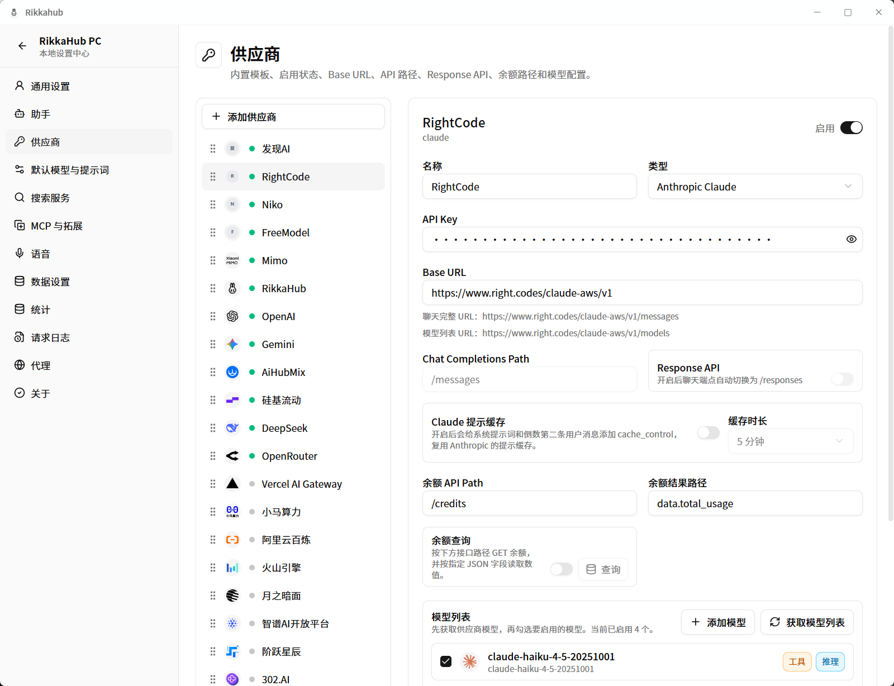
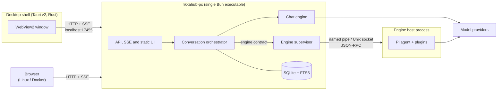

<div align="center"><a name="readme-top"></a>


# Rikkahub Desktop

**Rikkahub is a native LLM client with Pi and other agent implementations built in 🤖💬**

— runs on Windows, Linux and Docker.<br/>
Reconstructed on top of the [Android edition of RikkaHub][rikkahub] by [@RE][re-ovo].

**English** · [简体中文](README_ZH_CN.md) · [繁體中文](README_ZH_TW.md) · [Website][website] · [Download][releases-latest] · [Docker](#docker) · [Feedback][issues]

[![][release-shield]][releases]
[![][downloads-shield]][releases]
[![][docker-shield]][docker-link]
[![][ci-shield]][ci-link]<br/>
[![][platform-shield]](#-getting-started)
[![][license-shield]](LICENSE)
[![][stars-shield]][stars-link]
[![][issues-shield]][issues]

</div>

<details>
<summary><kbd>Table of contents</kbd></summary>

- [Rikkahub Desktop](#rikkahub-desktop)
  - [✨ Features](#-features)
    - [💬 Chat](#-chat)
    - [🧠 Models and providers](#-models-and-providers)
    - [🛠️ Workspace sessions](#️-workspace-sessions)
    - [🗂️ Conversations you own](#️-conversations-you-own)
    - [🔓 Open and configurable](#-open-and-configurable)
    - [🔍 Search, voice and images](#-search-voice-and-images)
    - [💾 Data and backup](#-data-and-backup)
    - [🖥️ Desktop experience](#️-desktop-experience)
    - [🌊 To Be Continued…](#-to-be-continued)
  - [💎 Sponsors](#-sponsors)
  - [🚀 Getting started](#-getting-started)
    - [Windows](#windows)
    - [Linux](#linux)
    - [Docker](#docker)
    - [Community builds](#community-builds)
    - [First steps](#first-steps)
    - [Command-line options](#command-line-options)
  - [🔒 Privacy and security](#-privacy-and-security)
  - [🏗️ Architecture](#️-architecture)
  - [⌨️ Development](#️-development)
    - [Repository layout](#repository-layout)
    - [Setup](#setup)
    - [Running locally](#running-locally)
    - [Checks and tests](#checks-and-tests)
    - [Smoke tests](#smoke-tests)
    - [Building](#building)
    - [Versioning and releases](#versioning-and-releases)
    - [Maintaining Pi](#maintaining-pi)
  - [🤝 Contributing](#-contributing)
  - [🙏 Credits](#-credits)
  - [⭐ Star history](#-star-history)
  - [📄 License](#-license)
  - [🔗 Friend links](#-friend-links)

</details>

## ✨ Features

Rikkahub Desktop is a desktop client rebuilt from the RikkaHub Android app. It runs as a native Windows app, as a self-contained Linux binary, or in Docker, where you open it in a browser. A [community build](#community-builds) is available for macOS.

<table>
  <tr>
    <td width="50%" valign="top">
      <b>💬 Multi-provider chat</b><br/>
      Hosted or local models over the OpenAI, Anthropic and Gemini protocols, with branches, assistants, memory, MCP, web search and voice.
    </td>
    <td width="50%" valign="top">
      <b>🛠️ Pi on the desktop</b><br/>
      Run the Pi agent in a workspace. It takes actions and runs code to carry out what you have in mind.
    </td>
  </tr>
  <tr>
    <td width="50%" valign="top">
      <b>🗂️ Conversations you own</b><br/>
      Agent workspace sessions live in the same library as your chats, so they can be edited, branched, searched and backed up. Engine upgrades and crashes never take your history with them.
    </td>
    <td width="50%" valign="top">
      <b>🔄 Two-way with the RikkaHub app</b><br/>
      Back up on your phone and restore on the desktop, or the other way round.
    </td>
  </tr>
  <tr>
    <td width="50%" valign="top">
      <b>🔓 Open and configurable</b><br/>
      Every system prompt and built-in task prompt is visible and editable, and requests can carry your own headers and body fields.
    </td>
    <td width="50%" valign="top">
      <b>⚡ Prompt caching built in</b><br/>
      Tuned for cache hits, with cache breakpoints for Claude, cache routing for OpenAI, and cache warming during long agent turns.
    </td>
  </tr>
</table>

### 💬 Chat

<!--  -->

- **Built for long conversations**: very long chats stay smooth.
- **Message queue**: keep typing while the model answers. Queued messages are sent at the next break, in order.
- **Streaming Markdown** with code highlighting, LaTeX and tables. HTML, SVG and Mermaid blocks render in place.
- **Branches**: edit any message or regenerate any reply, keep every version, and fork a conversation from any point.
- **Assistants** with their own system prompt, model, parameters, preset messages, regex replacement and template variables such as `{{model_name}}` and `{{cur_datetime}}`.
- **Memory**, per assistant or shared across assistants, with recent-chat references and the current time injected after a long pause.
- **MCP / Skills**: MCP servers over Streamable HTTP or SSE, with OAuth sign-in; skills imported from GitHub or a local file. Both can be set as defaults per assistant or chosen per conversation.
- **Lorebooks and prompt injection**: a lorebook entry is injected when recent messages match its keywords or regex, or always if you set it to; a selected prompt injection applies on every turn. Either can go before or after the system prompt, at the top or bottom of the chat, or at a set message depth.
- **Full-text search** across all conversations, in-place translation, one-click prompt optimization, and export to Markdown or an image.

### 🧠 Models and providers

<!--  -->

- **Native protocols**: OpenAI Chat Completions and Responses, Anthropic Messages, Google Gemini and the Gemini Interactions API. Any OpenAI-compatible endpoint works, including local models served by [Ollama][ollama], [LM Studio][lmstudio] or [llama.cpp][llamacpp].
- **Many providers**: OpenAI / Anthropic / Google Gemini, plus any OpenAI-compatible API.
- **Subscription sign-in** instead of an API key: ChatGPT, Claude Pro / Max, SuperGrok / X Premium, GitHub Copilot and Kimi Code. Tokens refresh automatically. Claude subscriptions work in workspace sessions only.
- **Local models** through Ollama, LM Studio or the llama.cpp server: point an OpenAI-compatible provider at the local address, such as `http://localhost:11434/v1` for Ollama.
- **Cache optimization**: several caching measures that save you tokens.
- **Seven reasoning levels** from *Off* to *Max*, mapped to each provider's own parameters.

### 🛠️ Workspace sessions

<!--  -->

Workspace sessions are powered by [Pi][pi], an open-source coding agent. Open a project folder, or use the default folder that Rikkahub Desktop manages, and Pi reads, writes and runs code in it.

- **Plugins** from the Pi package ecosystem, with support for custom marketplace sources.
- **No extra setup on Windows**: a bundled bash is used when no Git Bash is found.
- **Reviewable output**: edits appear as diffs and commands as terminal output, with a file panel next to the conversation.
- **Steering**: messages sent while Pi is working reach it at its next step.

### 🗂️ Conversations you own

Workspace sessions sit in the same library as your chats, and Rikkahub Desktop stores and manages them. Pi is the engine that drives a session, not its owner: on every turn it reads the history from the app, hands each step's result back, and keeps no session files of its own.

- **Upgrades never lose history**: when the engine is upgraded, crashes, or hangs and is restarted automatically, the conversation stays intact. At most the turn in progress ends with an error.
- **Agent sessions are editable too**: change any message, regenerate, switch branches or fork from the middle, exactly as in a chat. The next turn continues from the edited history.
- **Native integration, no command line in between**: Pi is embedded from source, and messages, tool calls and approval requests reach the app as structured events instead of parsed terminal output. Pi's version is pinned with the app, so a separate upgrade cannot break the interface.
- **Searchable and portable**: full-text search covers agent sessions, which move with your backups and can be exported to the RikkaHub app.
- **One setup for both modes**: providers and subscription sign-ins, MCP and skills, proxy and usage statistics are shared by chat mode and workspace sessions, so there is nothing to configure twice for the agent.
- **For developers**: an engine is a driver behind a JSON-serializable contract. Storage, UI, search, backup, approvals and model access come from the app, and the engine runs in its own supervised process. Adding an engine does not require rebuilding any of these.

### 🔓 Open and configurable

- **Every prompt is editable**: assistant system prompts, and the prompts behind titles, suggestions, translation, OCR, context compression and prompt optimization.
- **Request-level control**: custom headers per provider, model or assistant, custom request body fields per model or assistant, and a separate endpoint and API key per model.
- **Scene models**: choose separate models for titles and suggestions, translation, prompt optimization, context compression, OCR and image generation.
- **Custom search**: connect any other search API with a short JavaScript script.

### 🔍 Search, voice and images

- **20 web-search services**, including Tavily, Exa, Brave, Perplexity, Jina, Firecrawl, SearXNG, custom JS, …
- **Multiple keys per service**: when a key is rejected or runs out of quota, the next one takes over automatically.
- **Text to speech** with 12 engines, plus real-time speech recognition and a hands-free voice mode.
- **Image generation and editing** with OpenAI-style image APIs and Google Imagen, plus a gallery.
- **Attachments**: images, PDF, DOCX, PPTX and EPUB. Models without vision input can fall back to an OCR model.

### 💾 Data and backup

- **Local storage**: conversations are kept in a local SQLite database. Saving writes only what changed, so long conversations stay fast.
- **Two-way backup**: import app backups on the desktop, and restore desktop backups in the app.
- **Cloud backup** to WebDAV or any S3-compatible storage.

### 🖥️ Desktop experience

<!--  -->

- Color themes (Claude / Mono / Vermillion / your own) + 🌙 dark mode.
- Multiple tabs, with side-by-side split view.
- Customizable keyboard shortcuts.
- System proxy by default, with manual and direct modes, a bypass list and a custom User-Agent.
- Usage statistics with cache hit rates, and a request log for troubleshooting.

### 🌊 To Be Continued…

<div align="center">

<picture>
  <source media="(prefers-color-scheme: dark)" srcset=".github/assets/whale-dark.svg" />
  
</picture>

**Pi is the first. It will not be the last.**

Conversations are already stored apart from any engine, so when the next one arrives, your history carries straight on.<br/>
*Something is rising from the deep.*

</div>

<div align="right">

[![][back-to-top]](#readme-top)

</div>

## 💎 Sponsors

Thanks to the following sponsors for supporting Rikkahub Desktop's development.

<table>
  <tr>
    <td width="120" align="center">
      <a href="https://naapi.cc"></a>
    </td>
    <td>
      <a href="https://naapi.cc"><b>钠API</b></a><br/>
      One-stop access to 100+ top global models, including ChatGPT, Claude and Gemini, with competitive pricing
      and superior stability.
    </td>
  </tr>
</table>

You can also support the project on [Afdian][afdian].

<div align="right">

[![][back-to-top]](#readme-top)

</div>

## 🚀 Getting started

### Windows

Download `Rikkahub_<version>_x64-setup.exe` from the [latest release][releases-latest] and run it.

- Installs per user to `%LOCALAPPDATA%\Rikkahub\` by default. No administrator rights are needed.
- Asks where to keep your data (conversations, settings, uploads). The default is `<install dir>\pc-data\`. Choose a drive with enough space, because the data folder cannot be moved from inside the app yet.
- Bundles the WebView2 bootstrapper, so it runs on Windows 10 1809+ and Windows 11 out of the box.
- Checks for a new version at startup, and you can check manually in *Settings → About*. An update downloads the new installer and installs over the current version, keeping your data. Uninstalling never deletes the data folder.

Each release also has `Rikkahub_<version>_portable.zip`. Unzip it and run `rikkahub-pc.exe`, which opens the interface in your browser and keeps its data in the `pc-data\` folder next to it.

### Linux

Each release has `Rikkahub_<version>_linux_x64.tar.gz`, a self-contained binary plus the web UI:

```bash
tar xzf Rikkahub_<version>_linux_x64.tar.gz
cd rikkahub-pc
./rikkahub-pc            # serves http://localhost:17455 and opens it; data goes to ./pc-data/
```

On a headless server, add `--no-open`. For LAN access, use `--host 0.0.0.0` and set `--password` (see [Command-line options](#command-line-options)). The Linux build updates itself in place: the new version replaces the files in the same folder and takes effect after a restart.

A few features call system tools. Missing ones are listed at startup, and the rest of the app works without them.

| Package | Used for |
| :-- | :-- |
| `espeak-ng` | System text to speech |
| `xclip` (X11) or `wl-clipboard` (Wayland) | The clipboard tool |
| `unzip`, `zip` | Backup export and restore, skill import from ZIP |

```bash
sudo apt install espeak-ng xclip unzip zip    # Debian / Ubuntu
sudo dnf install espeak-ng xclip unzip zip    # Fedora / RHEL
```

### Docker

Multi-arch images (amd64 / arm64) are published to GitHub Container Registry:

```bash
docker run -d --name rikkahub \
  -p 8080:8080 \
  -v ./pc-data:/app/pc-data \
  -e RIKKAHUB_PASSWORD=change-me \
  ghcr.io/yuh-g/rikkahub-desktop:latest
```

Or with Docker Compose:

```yaml
services:
  rikkahub:
    image: ghcr.io/yuh-g/rikkahub-desktop:latest
    container_name: rikkahub
    ports:
      - "8080:8080"
    volumes:
      - ./pc-data:/app/pc-data
    environment:
      RIKKAHUB_PASSWORD: change-me
      # HTTPS_PROXY: http://proxy.example:3128   # uncomment if you need a proxy
    restart: unless-stopped
```

Then open `http://localhost:8080`.

- **Tags** follow releases (`v2.0.0-preview-v5`, …), `latest` is the newest release and `main` tracks the main branch. Images are signed with cosign.
- **To update**, pull the new image and recreate the container. The in-app updater is disabled in containers.
- **Proxy** settings come from the container's `HTTP_PROXY`, `HTTPS_PROXY` and `NO_PROXY` environment variables.
- `unzip` and `zip` are included. Clipboard and system speech are not available in a headless container.
- To build the image yourself, run `docker build -t rikkahub .` in the repository root.

> [!IMPORTANT]
> The container listens on all interfaces. Set `RIKKAHUB_PASSWORD` whenever anyone else can reach the port, otherwise they can read your conversations and API keys.

<details>
<summary><b>Reverse proxy (nginx)</b></summary>

<br/>

Keep the `Host` header, because the server rejects state-changing requests whose `Origin` doesn't match `Host`
(CSRF protection), and disable buffering for the event streams:

```nginx
map $http_upgrade $connection_upgrade {
    default upgrade;
    ''      close;
}

server {
    listen 443 ssl;
    server_name rikka.example.com;
    # ssl_certificate ...; ssl_certificate_key ...;

    location / {
        proxy_pass http://127.0.0.1:8080;          # 17455 for a bare binary
        proxy_set_header Host $host;
        proxy_http_version 1.1;
        proxy_set_header Upgrade $http_upgrade;   # WebSocket (voice input)
        proxy_set_header Connection $connection_upgrade;
        proxy_buffering off;
        proxy_read_timeout 1h;                    # long-lived generation streams
        client_max_body_size 0;                   # backup uploads can be hundreds of MB
    }
}
```

</details>

### Community builds

These packages are maintained by community members, not by this project, and may lag behind the latest release.
Please report packaging issues to their maintainers.

| Platform | How to install | Maintainer |
| :-- | :-- | :-- |
| macOS | `.dmg` for Apple Silicon and Intel from [P-A-N-52/rikkahub-desktop][mac-port] | [@P-A-N-52](https://github.com/P-A-N-52) |
| Debian / Ubuntu / Mint | `.deb` from [Releases][releases] or the [cloud drive][cloud-drive], then `sudo apt install ./rikkahub-pc_*_amd64.deb` | [@Noah0932](https://github.com/Noah0932) |
| Arch / Manjaro | `.pkg.tar.zst` from [Releases][releases] or the [cloud drive][cloud-drive], then `sudo pacman -U rikkahub-pc-*-x86_64.pkg.tar.zst` | [@Noah0932](https://github.com/Noah0932) |
| NixOS / Nix | `nur.repos.af-nur.rikkahub-desktop` (built from source; binary cache `af-nur.cachix.org`)<br/>`nur.repos.af-nur.rikkahub-desktop-bin` (repackages the release binary) | [@AstralFlare-owo](https://github.com/AstralFlare-owo) |

### First steps

1. **Add a model**: open *Settings → Models → Providers* and enter an API key for any provider. With a ChatGPT, Claude, SuperGrok, GitHub Copilot or Kimi Code subscription, click *Sign in* on that provider instead.
2. **Start chatting**: create a new conversation on the home page, then pick the model, reasoning level and web search in the input box.
3. **Open a workspace**: click **+** next to the tabs, choose *Default workspace* or *Open existing folder*, then pick a permission level at the bottom left of the input box.
4. **Move over from the app**: export a backup in the RikkaHub app and import it in *Settings → Data → Backup & restore*. Conversations, assistants and settings come across together.

### Command-line options

| Flag | Environment variable | Default | Purpose |
| :-- | :-- | :-- | :-- |
| `--port <n>` | `PORT` | `17455` (`8080` in containers) | Port to listen on. Outside containers, a taken port moves to the next free one. |
| `--host <addr>` | `RIKKAHUB_HOST` | `127.0.0.1` and `::1` (`0.0.0.0` in containers) | Address to bind. Use `0.0.0.0` for LAN access. |
| `--password <pw>` | `RIKKAHUB_PASSWORD` | none | Access password for the web UI and API. |
| `--no-open` | | opens the browser | Don't open a browser window at startup. |
| | `RIKKAHUB_PC_DATA_DIR` | `pc-data/` next to the binary | Data folder. |
| | `RIKKAHUB_ANALYTICS` | on in release builds | `0` turns off anonymous usage statistics. |

<div align="right">

[![][back-to-top]](#readme-top)

</div>

## 🔒 Privacy and security

- **Local-first.** No account is required. Conversations, settings and keys stay in your data folder, and model
  requests go directly from your machine, or through the proxy you set, to the providers you configure.
- **Other network requests.** Update checks query GitHub, model metadata such as context limits comes from
  [models.dev](https://models.dev) at most once a day, the plugin marketplace queries the npm registry, and
  search-result favicons and Mermaid previews load from public services.
- **Anonymous active-user statistics.** Release builds send a small request at startup and every 10 minutes with a random
  device ID, the app version, the OS and daily counters such as messages sent, active minutes and failed requests.
  No conversation content, prompts, model names or file names are collected. Set `RIKKAHUB_ANALYTICS=0` to turn it
  off; builds run from source never send it.
- **Local-only by default.** The desktop build listens on the loopback address only, and API requests from other
  web origins are rejected. Set an access password before exposing the server on a network.
- **Workspace boundaries.** Writes outside the workspace folder need your approval unless the permission level is
  *Full access*. The read tool and shell commands can reach files outside the folder.
- **Plugins** run on your computer in the engine process, not in a sandbox. Install only plugins you trust.
- **Shared deployments.** The `scrape_web` tool fetches whatever URL the model requests from the machine running
  Rikkahub Desktop. On a LAN or public deployment, restrict outbound network access if internal services must not
  be reachable (SSRF).

<div align="right">

[![][back-to-top]](#readme-top)

</div>

## 🏗️ Architecture



- **One executable**: `bun build --compile` packs the backend and the Bun runtime into a single file. The React UI
  is served from the `web-ui/` folder next to it, so the same binary serves the desktop window, a browser or a
  container. On Windows, a small Tauri shell starts it as a sidecar and owns the window, tray and installer.
- **Engines behind a contract**: The orchestrator talks to engines only through a JSON-serializable contract: start a
  turn, stream events, request approval, load and append session entries. The chat engine runs in process; Pi and
  its plugins run in an engine host process that a supervisor starts on demand, health-checks every 2 seconds,
  restarts after a crash and recycles when plugins change.
- **Two-layer storage**: Each conversation is stored as an engine-neutral record, which the UI, search and the app
  export read. Each engine keeps its native entries next to it and reuses them only while they still match the
  neutral record, so edits, branches and engine switches never leave an engine working from stale history.
- **Built for long sessions**: Saving reconciles only the nodes that changed, the full-text index is updated per
  node, and cross-process traffic carries only the new part of each output and request body. Tests fail when these
  costs start to grow with conversation length.

<details>
<summary><b>Tech stack</b></summary>

<br/>

| Layer | Technology |
| :-- | :-- |
| Runtime and build | [Bun][bun] 1.4 (`bun build --compile`), TypeScript (strict) |
| Desktop shell | [Tauri v2][tauri], Rust, NSIS installer, WebView2 |
| Frontend | [React 19][react], [React Router 7][react-router] (SPA mode), [Tailwind CSS v4][tailwind], [shadcn/ui][shadcn], [Zustand][zustand], [TanStack Query][tanstack-query] |
| Rendering | [Streamdown][streamdown], [Shiki][shiki], [KaTeX][katex], Mermaid |
| Storage | `bun:sqlite` with FTS5 (trigram) |
| Workspace agent | [Pi][pi] (vendored, one local patch) |
| Documents | [MuPDF][mupdf] (WebAssembly) for PDF; built-in parsers for DOCX, PPTX and EPUB |
| i18n | [i18next][i18next] (en-US, zh-CN) |

</details>

<div align="right">

[![][back-to-top]](#readme-top)

</div>

## ⌨️ Development

### Repository layout

```text
rikkahub-desktop/
├── pc-server/              # Bun backend: API, conversation orchestration, both engines, backup, search, voice
│   ├── conversations/      #   orchestrator, SSE broadcast, engine-neutral conversation records
│   ├── engines/            #   the app↔engine contract, the chat engine driver, the model outlet
│   ├── inference-engine/   #   chat engine: provider clients, tool loop, approvals
│   ├── pi-engine/          #   the Pi driver and the glue over Pi's sources
│   ├── subprocess-engine/  #   engine host process: channel, framing, handshake, supervisor
│   └── scripts/            #   smoke tests and build scripts
├── web-ui/                 # React 19 single-page app; src-tauri/ is the Windows desktop shell
├── pi/                     # pinned Pi sources (not in this repository; restore as shown below)
├── pi-patches/             # this project's patches to Pi
├── pi-model-data/          # offline snapshot of Pi's built-in model catalog
├── icons/  fonts/          # provider icons and bundled fonts
├── docs/                   # website and screenshots
└── functions/              # server side of the anonymous usage statistics (Cloudflare Pages Functions)
```

When run from source, data goes to `pc-data/` in the repository root, which Git ignores. Point `RIKKAHUB_PC_DATA_DIR` at another folder to keep development data apart from your everyday data.

### Setup

**Prerequisites:** [Bun][bun] 1.4.5 (the version CI and releases pin; `bun build --compile` embeds whichever Bun runs it) and Git. Building the Windows installer also needs the [Rust][rustup] toolchain, [Visual Studio Build Tools 2022][vs-build-tools] with the *Desktop development with C++* workload, and [Git for Windows][git-for-windows], whose bash is packed into the app.

**Clone the repository and restore Pi.** The backend imports Pi's TypeScript sources directly, so `pi/` must hold a pinned Pi checkout with this project's patch and model-data snapshot applied. On Windows, run these commands in Git Bash:

```bash
git clone https://github.com/yuh-G/rikkahub-desktop.git
cd rikkahub-desktop

git clone --filter=blob:none --no-checkout https://github.com/earendil-works/pi.git pi
cd pi
git checkout dd30101cfc5b0609411dd80b6f93adbc14db14cf
git reset --hard
git apply --ignore-whitespace ../pi-patches/*.patch
bun install
mkdir -p packages/ai/src/providers/data
cp ../pi-model-data/*.json ../pi-model-data/.manifest.json packages/ai/src/providers/data/
bun packages/ai/scripts/check-model-data.ts
cd ..
```

The commit hash matches CI, the Dockerfile and the Linux release workflow. The last command checks the model-data snapshot: a snapshot that does not match the Pi version leaves the built-in model catalog empty.

### Running locally

Open two terminals in the repository root:

```bash
cd pc-server && bun install && bun run dev    # API on http://localhost:17455; does not open a browser
cd web-ui && bun install && bun run dev       # Vite on http://localhost:5173, proxies /api to 17455
```

Then open `http://localhost:5173` in any browser. Frontend changes hot-reload; restart `bun run dev` after backend changes. The custom title bar only appears in the desktop shell, and the rest of the interface works fully in a browser.

Workspace sessions run in an engine host process that the main program starts on demand, so there is nothing extra to launch. If the main program or the engine host exits abnormally, its startup record is left in `logs/` under the data folder.

### Checks and tests

The tests need `pc-server/assets/bash-bundle.tar.gz`, the Windows bash archive, which is not checked in. On Windows, build it from your Git for Windows install with `cd pc-server && bun run build:bash-bundle` (`bun run compile` does this too). On Linux and macOS a placeholder is enough: `echo dummy > pc-server/assets/bash-bundle.tar.gz`.

```bash
(cd pc-server && bun run typecheck && bun test)
(cd web-ui && bun run typecheck && bun run test:unit)
```

- `typecheck` in `pc-server` filters out diagnostics inside `pi/` and checks only this project's code and its use of Pi's API.
- The tests include architecture guards: for example, the main program must not load Pi, the conversation layer must not depend on a specific engine, and bytes sent across processes must not grow with conversation length. A failing guard explains which rule was broken.

> [!TIP]
> Unset `HTTP_PROXY`, `HTTPS_PROXY` and `ALL_PROXY` in the shell that runs tests and smoke tests. Bun applies them to loopback requests too, and the tests talk to local mock servers.

### Smoke tests

Most smoke tests start a real server or engine host process and run end to end against local mock providers, MCP and WebDAV servers. They need no network access and no real API keys. Run them from `pc-server`:

| Command | Covers | When to run |
| :-- | :-- | :-- |
| `bun run smoke:request-chain` | The full request chain: Chat Completions and Responses, streaming, prompt injection, skills, MCP, search and local tools, stop and regenerate, concurrent assistants, translation, context compression, backup and WebDAV, image generation | Before every commit (runs in CI) |
| `bun run smoke:backup-roundtrip` | Desktop → zip → desktop and desktop → app database → desktop round trips, attachment deduplication, and restores without an app database or with settings only | When backup, settings or storage change (runs in CI) |
| `bun run smoke:engine-contract` | Pi in a real engine host process: tool call → approval → steering → plugin inspection → abort, plus proxy settings reaching the host | When engines, the contract or Pi change (runs in CI) |
| `bun run smoke:upgrade` | Data written by the previous release opens in the new build and sends the model the same history on continuation; then the previous release's exe reopens what the new build wrote | When the storage format changes |
| `bun run smoke:proxy-behavior` | How the Bun runtime picks a proxy, and the app's per-request proxy decision | After upgrading Bun |
| `bun run smoke:embedded-bash` | Unpacking and running the bundled bash (Windows only) | When the bundled bash changes |
| `bun run smoke:pi-plugins` | Loading, tools, dialogs and commands of a pinned set of Pi ecosystem plugins inside the app | After upgrading Pi (needs local copies of the plugins) |

The last step of `smoke:upgrade` needs the previous release's `rikkahub-pc.exe`. It looks in the portable folder under `dist/` by default, or you can point `RIKKAHUB_UPGRADE_BASELINE_EXE` at it; when it is missing, the step is skipped with an explanation. Smoke tests use local ports between 18100 and 18300; if one is taken, override it with `SMOKE_PC_PORT` and the related variables.

### Building

```powershell
# Windows installer: compiles the server sidecar, builds the UI, then the NSIS installer
cd web-ui
bun run tauri:build
# → web-ui/src-tauri/target/release/bundle/nsis/Rikkahub_<version>_x64-setup.exe
```

If the build cannot find MSVC's `link.exe` (Git Bash ships its own `link`) or fails on non-ASCII characters in the project path, run `bun run compile` in `pc-server`, then `web-ui\src-tauri\tauri-msvc.cmd build`. The wrapper activates the MSVC environment and builds in `C:\rikkahub-build`.

```bash
# Windows portable folder: dist/ runs as is (rikkahub-pc.exe + web-ui/ + icons/ + fonts/)
cd web-ui && bun run build                  # builds the UI and copies it to dist/web-ui/
cd ../pc-server && bun run compile          # → dist/rikkahub-pc.exe, and syncs icons/ and fonts/

# Linux binary
cd web-ui && bun run build
cd ../pc-server && bun run compile:linux    # → dist/rikkahub-pc

# Docker image (multi-arch builds run in CI)
docker build -t rikkahub .
```

> [!NOTE]
> On Windows, Git converts line endings to CRLF by default, and the image build applies the patches in `pi-patches/` inside the container. When building the image on Windows, use the committed sources as the build context: `git -c core.autocrlf=false archive HEAD | docker build -t rikkahub -`.

### Versioning and releases

- **The version number** appears in four places: `pc-server/updates/index.ts`, `web-ui/src-tauri/tauri.conf.json`, `web-ui/src-tauri/Cargo.toml` and the About page. `cd pc-server && bun run version:bump <version>` changes all four, and CI checks that they agree. The version pointer in `dist/latest.txt` is updated by hand.
- **Pushing a `v*.*.*` tag** makes GitHub Actions build the Linux `tar.gz`, attach it to the matching Release, and publish the Docker image. The Windows installer and portable build are made locally and uploaded to the same Release.
- **In-app updates** find release assets by file name (`Rikkahub_<tag>_x64-setup.exe`, `Rikkahub_<tag>_linux_x64.tar.gz`), so do not rename them when uploading.

### Maintaining Pi

Pi is pinned to one upstream commit as source, and this project's changes live as patches in `pi-patches/`. Every patch needs three things: a `[RIKKAHUB PATCH: <name>]` marker in the code, an exported patch file in `pi-patches/`, and a host-side test that locks its behavior, so a lost patch fails the tests. Patches only add features or injection points; Pi's sources are never changed just to silence type-check noise. `bun run typecheck` filters out diagnostics inside `pi/`, so after touching a Pi file, run `bunx tsc --noEmit` directly in `pc-server` and compare that file's diagnostics before and after the change to make sure none were added.

<details>
<summary><b>Upgrading Pi</b></summary>

<br/>

1. Read the Breaking Changes in each package's `CHANGELOG.md` between the current baseline and the target version, and check every Pi file the backend imports (`grep -rn "pi/packages/" pc-server --include=*.ts`) for compatibility.
2. Fetch the new version in `pi/`, create a rollback branch first, then rebase the local patches onto the new baseline. Confirm every `RIKKAHUB PATCH` marker survived and re-export `pi-patches/`. Drop any patch that upstream now supports natively.
3. Refresh the model-data snapshot. Do not run `generate-models`: it builds from that day's live data and cannot be reproduced. Generate offline from Pi's content-addressed catalog instead:

   ```bash
   cd pi
   REV=$(node -p "require('./nix/model-catalog.json').revision")
   curl -fsSL "https://pi.dev/api/models/revisions/${REV}?types=chat,image,classifier" -o ../models.all.json
   echo "${REV#sha256-}  ../models.all.json" | sha256sum -c -
   node packages/ai/scripts/hydrate-model-catalog.ts ../models.all.json
   node packages/ai/scripts/check-model-data.ts
   ```

   Then replace `pi-model-data/` with the `*.json` files and `.manifest.json` from `packages/ai/src/providers/data/`, and delete `models.all.json`.
4. Copy the new baseline's full commit hash into `.github/workflows/ci.yml` (two places), `.github/workflows/build-linux.yml`, the `Dockerfile` and this README.
5. Run both type checks and unit-test suites, `smoke:engine-contract` and `smoke:pi-plugins`, then compile a real exe and walk through a workspace session (tools, approvals, steering, compaction) and a subscription sign-in.

</details>

<div align="right">

[![][back-to-top]](#readme-top)

</div>

## 🤝 Contributing

Bug reports, feature ideas and pull requests are welcome. For larger changes, please [open an issue][issues] first
so we can agree on the approach.

- Pull requests target `main`. CI runs both type checks, both unit-test suites, the version consistency check,
  `cargo check` for the desktop shell, and the request-chain, backup and engine-contract smoke tests. Please run the
  [checks and tests](#checks-and-tests) locally before you open one.
- User-facing text goes into both `web-ui/app/locales/en-US` and `zh-CN`.
- When you change settings, enums or stored data, check that backups still round-trip with the RikkaHub app.

<a href="https://github.com/yuh-G/rikkahub-desktop/graphs/contributors">
  
</a>

## 🙏 Credits

- [RikkaHub][rikkahub] by [RE][re-ovo], the Android app whose product design and brand this project is built on.
- [Pi][pi] by Mario Zechner, the coding agent behind workspace sessions.
- [@karuboniru](https://github.com/karuboniru) for the Linux port and Docker support, and every contributor and
  community packager listed above.
- [LobeHub Icons](https://github.com/lobehub/lobe-icons) for the provider and model logos.

## ⭐ Star history

<a href="https://star-history.com/#yuh-G/rikkahub-desktop&Date">
  <picture>
    <source media="(prefers-color-scheme: dark)" srcset="https://api.star-history.com/svg?repos=yuh-G/rikkahub-desktop&type=Date&theme=dark" />
    
  </picture>
</a>

## 📄 License

Rikkahub Desktop uses a segmented dual license:

- **[GNU AGPL v3](https://www.gnu.org/licenses/agpl-3.0.html)** for non-commercial, personal, educational and
  research use, and for individuals or organizations with no more than 50 users in total.
- **A commercial license** for commercial use, for more than 50 users, or to avoid AGPL obligations. The contact
  addresses are in the license file.

See [LICENSE](LICENSE) for the full terms.

## 🔗 Friend links

- [LINUX DO](https://linux.do/), the new ideal community

<div align="right">

[![][back-to-top]](#readme-top)

</div>

<!-- LINK GROUP -->

[afdian]: https://afdian.com/a/mirsky
[back-to-top]: https://img.shields.io/badge/-BACK_TO_TOP-151515?style=flat-square
[bun]: https://bun.sh/
[ci-link]: https://github.com/yuh-G/rikkahub-desktop/actions/workflows/ci.yml
[ci-shield]: https://img.shields.io/github/actions/workflow/status/yuh-G/rikkahub-desktop/ci.yml?branch=main&label=ci&labelColor=black&logo=githubactions&logoColor=white&style=flat-square
[cloud-drive]: https://1842911757.share.123pan.cn/123pan/oW0UTd-irzxh
[docker-link]: https://github.com/yuh-G/rikkahub-desktop/pkgs/container/rikkahub-desktop
[docker-shield]: https://img.shields.io/badge/docker-ghcr.io-369eff?labelColor=black&logo=docker&logoColor=white&style=flat-square
[downloads-shield]: https://img.shields.io/github/downloads/yuh-G/rikkahub-desktop/total?color=45cc11&labelColor=black&style=flat-square
[git-for-windows]: https://gitforwindows.org/
[i18next]: https://www.i18next.com/
[issues]: https://github.com/yuh-G/rikkahub-desktop/issues
[issues-shield]: https://img.shields.io/github/issues/yuh-G/rikkahub-desktop?color=ff80eb&labelColor=black&style=flat-square
[katex]: https://katex.org/
[license-shield]: https://img.shields.io/badge/license-AGPL--3.0%20%2B%20commercial-white?labelColor=black&style=flat-square
[llamacpp]: https://github.com/ggml-org/llama.cpp
[lmstudio]: https://lmstudio.ai/
[mac-port]: https://github.com/P-A-N-52/rikkahub-desktop
[mupdf]: https://mupdf.com/
[ollama]: https://ollama.com/
[pi]: https://github.com/earendil-works/pi
[platform-shield]: https://img.shields.io/badge/platform-Windows%20%7C%20Linux%20%7C%20Docker-0078d4?labelColor=black&style=flat-square
[re-ovo]: https://github.com/re-ovo
[react]: https://react.dev/
[react-router]: https://reactrouter.com/
[release-shield]: https://img.shields.io/github/v/release/yuh-G/rikkahub-desktop?color=369eff&labelColor=black&logo=github&style=flat-square
[releases]: https://github.com/yuh-G/rikkahub-desktop/releases
[releases-latest]: https://github.com/yuh-G/rikkahub-desktop/releases/latest
[rikkahub]: https://github.com/rikkahub/rikkahub
[rustup]: https://rustup.rs/
[shadcn]: https://ui.shadcn.com/
[shiki]: https://shiki.style/
[stars-link]: https://github.com/yuh-G/rikkahub-desktop/stargazers
[stars-shield]: https://img.shields.io/github/stars/yuh-G/rikkahub-desktop?color=ffcb47&labelColor=black&style=flat-square
[streamdown]: https://streamdown.ai/
[tailwind]: https://tailwindcss.com/
[tanstack-query]: https://tanstack.com/query
[tauri]: https://tauri.app/
[vs-build-tools]: https://visualstudio.microsoft.com/visual-cpp-build-tools/
[website]: https://rikkahub-desktop.pages.dev/
[zustand]: https://zustand.docs.pmnd.rs/
