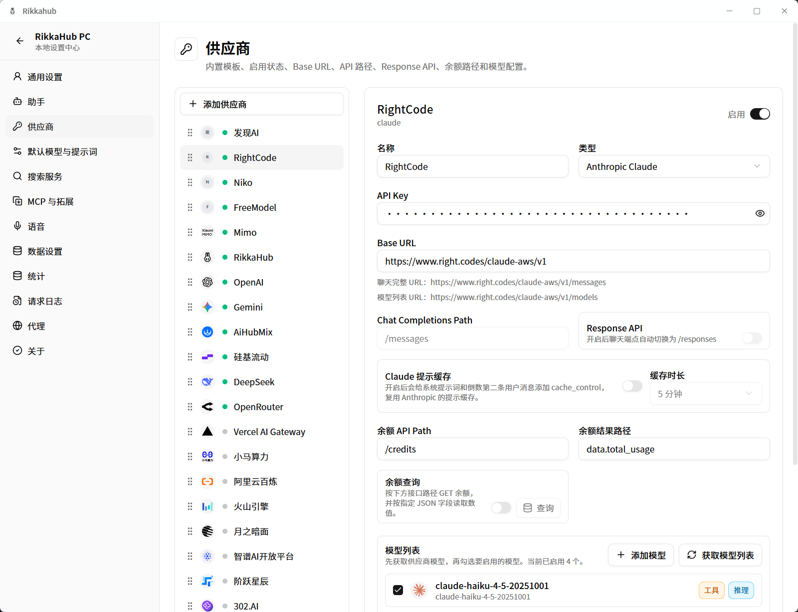
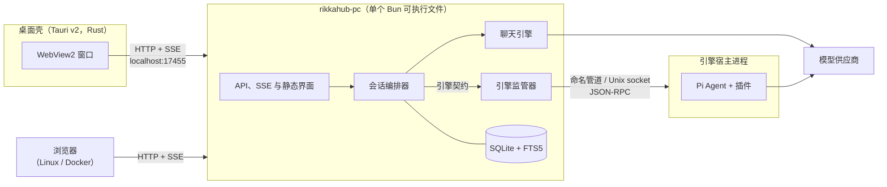

<div align="center"><a name="readme-top"></a>


# Rikkahub Desktop

**Rikkahub 是一款原生 LLM 客户端，嵌入集成 Pi 等多款 Agent 实现🤖💬**

—— 支持 Windows、Linux 与 Docker。<br/>
基于作者 [@RE][re-ovo] 开发的 Android 版 [RikkaHub][rikkahub] 重构而成。

[English](README.md) · **简体中文** · [繁體中文](README_ZH_TW.md) · [官网][website] · [下载][releases-latest] · [Docker](#docker) · [反馈][issues]

[![][release-shield]][releases]
[![][downloads-shield]][releases]
[![][docker-shield]][docker-link]
[![][ci-shield]][ci-link]<br/>
[![][platform-shield]](#-快速开始)
[![][license-shield]](LICENSE)
[![][stars-shield]][stars-link]
[![][issues-shield]][issues]

</div>

<details>
<summary><kbd>目录</kbd></summary>

- [Rikkahub Desktop](#rikkahub-desktop)
  - [✨ 功能特色](#-功能特色)
    - [💬 对话](#-对话)
    - [🧠 模型与供应商](#-模型与供应商)
    - [🛠️ 工作区会话](#️-工作区会话)
    - [🗂️ 会话归你所有](#️-会话归你所有)
    - [🔓 开放与可配置](#-开放与可配置)
    - [🔍 搜索、语音与图像](#-搜索语音与图像)
    - [💾 数据与备份](#-数据与备份)
    - [🖥️ 桌面体验](#️-桌面体验)
    - [🌊 To Be Continued…](#-to-be-continued)
  - [💎 赞助商](#-赞助商)
  - [🚀 快速开始](#-快速开始)
    - [Windows](#windows)
    - [Linux](#linux)
    - [Docker](#docker)
    - [社区构建](#社区构建)
    - [首次使用](#首次使用)
    - [命令行参数](#命令行参数)
  - [🔒 隐私与安全](#-隐私与安全)
  - [🏗️ 架构](#️-架构)
  - [⌨️ 开发](#️-开发)
    - [目录结构](#目录结构)
    - [环境准备](#环境准备)
    - [本地运行](#本地运行)
    - [检查与测试](#检查与测试)
    - [冒烟测试](#冒烟测试)
    - [构建](#构建)
    - [版本与发布](#版本与发布)
    - [维护 Pi](#维护-pi)
  - [🤝 参与贡献](#-参与贡献)
  - [🙏 致谢](#-致谢)
  - [⭐ Star 历史](#-star-历史)
  - [📄 许可证](#-许可证)
  - [🔗 友情链接](#-友情链接)

</details>

## ✨ 功能特色

Rikkahub Desktop 是一款桌面客户端，基于 RikkaHub Android 重构。它可以作为原生 Windows 应用运行，也可以作为自包含的 Linux 二进制或 Docker 容器运行，在浏览器中使用。macOS 用户可以使用[社区构建](#社区构建)。

<table>
  <tr>
    <td width="50%" valign="top">
      <b>💬 多供应商对话</b><br/>
      通过 OpenAI、Anthropic、Gemini 协议接入云端或本地模型，支持消息分支、多助手、记忆、MCP、联网搜索与语音。
    </td>
    <td width="50%" valign="top">
      <b>🛠️ 桌面端的 Pi</b><br/>
      在工作区中运行 Pi Agent，根据你的想法，执行动作、运行代码。
    </td>
  </tr>
  <tr>
    <td width="50%" valign="top">
      <b>🗂️ 会话归你所有</b><br/>
      Agent 工作区会话与普通对话存放在同一个会话库中，支持编辑、切换分支、搜索和备份。引擎升级或崩溃都不会带走历史。
    </td>
    <td width="50%" valign="top">
      <b>🔄 与 RikkaHub APP 双向互通</b><br/>
      手机上的备份可以在桌面端恢复，桌面端的备份也可以在 APP 中恢复。
    </td>
  </tr>
  <tr>
    <td width="50%" valign="top">
      <b>🔓 开放与可配置</b><br/>
      系统提示词与各项内置任务的提示词公开透明可编辑，请求可以附加自定义请求头与请求体字段。
    </td>
    <td width="50%" valign="top">
      <b>⚡ 内置提示缓存优化</b><br/>
      优化缓存命中，支持 Claude 缓存断点、OpenAI 缓存路由，以及 Agent 长任务期间的缓存预热。
    </td>
  </tr>
</table>

### 💬 对话

<!--  -->

- **性能优化**：超长对话依旧流畅运行。
- **消息队列**：模型回答时也能继续发送，排队的消息会在下一个自然间隙依次发出。
- **流式 Markdown 渲染**：代码高亮、LaTeX 与表格；HTML、SVG 和 Mermaid 代码块就地预览。
- **消息分支**：编辑任意消息或重新生成任意回复，保留每个版本，并可以从任意位置分叉出新会话。
- **助手**：独立的系统提示词、模型、参数、预设消息、正则替换，以及 `{{model_name}}`、`{{cur_datetime}}` 等模板变量。
- **记忆**：支持助手记忆与全局记忆两个层级，支持参考最近的对话，并在长时间无消息后注入模型当前时间。
- **MCP / Skill**：MCP 服务支持 Streamable HTTP 与 SSE 两种传输以及 OAuth 授权；技能可以从 GitHub 或本地文件导入。两者都可以按助手设为默认，也可以为单个会话选择。
- **世界书与提示词注入**：世界书条目在最近的消息命中关键词或正则时注入，也可以设为始终生效；提示词注入选中后每轮生效。两者都可以插入到系统提示词前后、对话开头或末尾，以及指定的消息深度。
- **全文搜索**：所有会话，就地翻译回复，一键优化提示词，导出为 Markdown 或图片。

### 🧠 模型与供应商

<!--  -->

- **原生协议**：OpenAI Chat Completions 与 Responses、Anthropic Messages、Google Gemini 以及 Gemini Interactions API。任意 OpenAI 兼容端点都能接入，包括 [Ollama][ollama]、[LM Studio][lmstudio] 和 [llama.cpp][llamacpp] 提供的本地模型。
- **多种供应商支持**：OpenAI / Anthropic / Google Gemini + 任意 OpenAI 兼容接口。
- **订阅登录**，无需 API Key：ChatGPT、Claude Pro / Max、SuperGrok / X Premium、GitHub Copilot 与 Kimi Code，凭证自动续期。Claude 订阅仅可用于工作区会话。
- **支持本地模型**：通过 Ollama / LM Studio / llama.cpp server，将 OpenAI 兼容供应商指向本地地址即可（如 Ollama 的 `http://localhost:11434/v1`）。
- **缓存优化**：多种缓存优化设计，拯救你的 Token。
- **七档推理强度**，从「关闭」到「最大」，按各供应商自己的参数映射。

### 🛠️ 工作区会话

<!--  -->

工作区会话由开源编程 Agent [Pi][pi] 驱动。打开一个项目文件夹，或使用 Rikkahub Desktop 管理的默认文件夹，Pi 即可在其中读写文件、运行代码。

- **插件**：支持 Pi 生态插件包，支持自定义插件市场源。
- **Windows 无需额外配置**：内置 Bash，在未发现本地 Git Bash 时使用。
- **结果可审阅**：修改以差异对比呈现，命令以终端输出呈现，文件面板与会话并排。
- **执行中插话**：Pi 工作时发出的消息，会在它的下一步被接收。

### 🗂️ 会话归你所有

工作区会话与普通对话位于同一个会话库，由 Rikkahub Desktop 保存和管理。Pi 是驱动会话的引擎，不是会话的所有者：它每一轮从应用读取历史，把每一步的结果交还给应用，自身不保存会话文件。

- **升级不丢历史**：引擎升级、崩溃，或卡住后被自动重启，会话记录都原样保留，最多只有正在进行的那一轮以错误结束。
- **Agent 会话也能编辑**：修改任意一条消息、重新生成、切换分支、从中途分叉出新会话，与普通对话完全一致，下一轮直接按改动后的历史继续。
- **原生接入，不经命令行**：Pi 以源码形式嵌入，消息、工具调用与审批请求都以结构化事件交给应用，不解析终端输出；Pi 的版本随应用一起锁定，不会因单独升级而失配。
- **搜得到，带得走**：全文搜索覆盖 Agent 会话；会话随备份迁移，也能导出到 RikkaHub APP。
- **一套配置，两种模式**：供应商与订阅登录、MCP 与技能、代理和用量统计都由对话模式和工作区会话共用，不用为 Agent 另配一遍。
- **对开发者**：引擎是一套可 JSON 序列化契约背后的驱动。存储、界面、搜索、备份、审批与模型接入都由应用提供，引擎运行在受监管的独立进程中。接入新引擎时，这些部分都无需重写。

### 🔓 开放与可配置

- **所有提示词均可编辑**：助手的系统提示词，以及标题、建议、翻译、OCR、上下文压缩和提示词优化背后的提示词。
- **请求级控制**：供应商、模型、助手三级自定义请求头，模型与助手级自定义请求体字段，每个模型可单独指定端点与 API Key。
- **场景模型**：标题与聊天建议、翻译、提示词优化、上下文压缩、OCR 与图像生成都可以单独指定模型。
- **自定义搜索**：用一小段 JavaScript 脚本接入任意其他搜索 API。

### 🔍 搜索、语音与图像

- **20 种联网搜索服务**：包括 Tavily、Exa、Brave、Perplexity、Jina、Firecrawl、SearXNG、自定义 JS、…
- **多 Key 管理**：失效或额度用尽时自动切换到下一个。
- **文字转语音**：支持 12 种引擎，搭配实时语音识别与免手动语音模式。
- **图像生成与编辑**：兼容 OpenAI 风格的图像接口与 Google Imagen，附带图库。
- **附件**：图片、PDF、DOCX、PPTX 与 EPUB。不支持视觉输入的模型可以交由 OCR 模型识别图片。

### 💾 数据与备份

- **本地存储**：会话由本地 SQLite 存储。保存时只写入有变化的部分，长会话同样流畅。
- **双向备份**：桌面端可以导入 APP 的备份，桌面端的备份也可以在 APP 中恢复。
- **云端备份**：支持 WebDAV 与任意 S3 兼容存储。

### 🖥️ 桌面体验

<!--  -->

- 多套主题色（Claude / Mono / Vermillion / 自定义） + 🌙 深色模式
- 多标签页，支持左右分栏。
- 自定义快捷键位设计。
- 默认跟随系统代理，也可以手动指定或强制直连，支持代理白名单与自定义 User-Agent。
- 含缓存命中率的用量统计，以及便于排查问题的请求日志。

### 🌊 To Be Continued…

<div align="center">

<picture>
  <source media="(prefers-color-scheme: dark)" srcset=".github/assets/whale-dark.svg" />
  
</picture>

**Pi 是第一位，但不会是最后一位。**

会话本就独立于引擎保存，下一位到来时，你的历史会原样接续。<br/>
*深海之下，有什么正在缓缓上浮。*

</div>

<div align="right">

[![][back-to-top]](#readme-top)

</div>

## 💎 赞助商

感谢以下赞助商对 Rikkahub Desktop 开发的支持。

<table>
  <tr>
    <td width="120" align="center">
      <a href="https://naapi.cc"></a>
    </td>
    <td>
      <a href="https://naapi.cc"><b>钠API</b></a><br/>
      提供 ChatGPT、Claude、Gemini 等 100+ 全球顶级模型的统一接口，主打有竞争力的价格与出色的稳定性。
    </td>
  </tr>
</table>

也可以通过[爱发电][afdian]支持本项目。

<div align="right">

[![][back-to-top]](#readme-top)

</div>

## 🚀 快速开始

### Windows

从[最新发布][releases-latest]下载 `Rikkahub_<版本号>_x64-setup.exe` 并运行。

- 默认按用户安装到 `%LOCALAPPDATA%\Rikkahub\`，无需管理员权限。
- 安装时会询问数据（会话、设置、上传文件）的保存位置，默认为 `<安装目录>\pc-data\`。请选择空间充足的磁盘，因为目前还不能在应用内更换数据目录。
- 自带 WebView2 引导程序，Windows 10 1809+ 与 Windows 11 可直接运行。
- 应用启动时会检查新版本，也可以在「设置 → 关于」中手动检查。更新会下载新的安装包并覆盖安装，数据保持不变；卸载也不会删除数据目录。

每个版本还提供免安装的 `Rikkahub_<版本号>_portable.zip`：解压后运行 `rikkahub-pc.exe`，它会在浏览器中打开界面，数据保存在同目录的 `pc-data\` 中。

### Linux

每个版本都提供 `Rikkahub_<版本号>_linux_x64.tar.gz`，内含自包含的二进制与网页界面：

```bash
tar xzf Rikkahub_<版本号>_linux_x64.tar.gz
cd rikkahub-pc
./rikkahub-pc            # 在 http://localhost:17455 提供服务并自动打开；数据保存在 ./pc-data/
```

无头服务器上运行时加 `--no-open`；需要从局域网访问时，用 `--host 0.0.0.0` 并设置 `--password`（见[命令行参数](#命令行参数)）。Linux 版支持应用内更新：新版本会在原目录中替换，重启后生效。

部分功能会调用系统工具。缺少的工具会在启动时列出，其余功能不受影响。

| 软件包 | 用途 |
| :-- | :-- |
| `espeak-ng` | 系统文字转语音 |
| `xclip`（X11）或 `wl-clipboard`（Wayland） | 剪贴板工具 |
| `unzip`、`zip` | 备份导出与恢复、从 ZIP 导入技能 |

```bash
sudo apt install espeak-ng xclip unzip zip    # Debian / Ubuntu
sudo dnf install espeak-ng xclip unzip zip    # Fedora / RHEL
```

### Docker

多架构镜像（amd64 / arm64）发布在 GitHub Container Registry：

```bash
docker run -d --name rikkahub \
  -p 8080:8080 \
  -v ./pc-data:/app/pc-data \
  -e RIKKAHUB_PASSWORD=change-me \
  ghcr.io/yuh-g/rikkahub-desktop:latest
```

也可以使用 Docker Compose：

```yaml
services:
  rikkahub:
    image: ghcr.io/yuh-g/rikkahub-desktop:latest
    container_name: rikkahub
    ports:
      - "8080:8080"
    volumes:
      - ./pc-data:/app/pc-data
    environment:
      RIKKAHUB_PASSWORD: change-me
      # HTTPS_PROXY: http://proxy.example:3128   # 需要代理时取消注释
    restart: unless-stopped
```

然后打开 `http://localhost:8080`。

- **镜像标签**跟随发布版本（`v2.0.0-preview-v5` 等），`latest` 为最新发布版，`main` 跟随主分支。镜像使用 cosign 签名。
- **更新**时拉取新镜像并重建容器即可，容器内不提供应用内更新。
- **代理**跟随容器的 `HTTP_PROXY`、`HTTPS_PROXY` 与 `NO_PROXY` 环境变量。
- 镜像已内置 `unzip` / `zip`；无头容器中没有剪贴板和系统语音。
- 如需自行构建，在仓库根目录运行 `docker build -t rikkahub .`。

> [!IMPORTANT]
> 容器监听所有网卡。只要他人能访问该端口，就请设置 `RIKKAHUB_PASSWORD`，否则对方可以看到你的会话和 API Key。

<details>
<summary><b>反向代理（nginx）</b></summary>

<br/>

需要保留 `Host` 请求头（服务端会拒绝 `Origin` 与 `Host` 不一致的写请求，以防 CSRF），并关闭事件流的缓冲：

```nginx
map $http_upgrade $connection_upgrade {
    default upgrade;
    ''      close;
}

server {
    listen 443 ssl;
    server_name rikka.example.com;
    # ssl_certificate ...; ssl_certificate_key ...;

    location / {
        proxy_pass http://127.0.0.1:8080;          # 直接运行二进制时为 17455
        proxy_set_header Host $host;
        proxy_http_version 1.1;
        proxy_set_header Upgrade $http_upgrade;   # WebSocket（语音输入）
        proxy_set_header Connection $connection_upgrade;
        proxy_buffering off;
        proxy_read_timeout 1h;                    # 长时间的生成流
        client_max_body_size 0;                   # 备份上传可能有几百 MB
    }
}
```

</details>

### 社区构建

以下安装包由社区成员维护，并非本项目官方维护，可能滞后于最新版本。打包相关问题请向对应的维护者反馈。

| 平台 | 安装方式 | 维护者 |
| :-- | :-- | :-- |
| macOS | 从 [P-A-N-52/rikkahub-desktop][mac-port] 下载 Apple Silicon 或 Intel 的 `.dmg` | [@P-A-N-52](https://github.com/P-A-N-52) |
| Debian / Ubuntu / Mint | 从 [Releases][releases] 或[云盘][cloud-drive]下载 `.deb`，然后 `sudo apt install ./rikkahub-pc_*_amd64.deb` | [@Noah0932](https://github.com/Noah0932) |
| Arch / Manjaro | 从 [Releases][releases] 或[云盘][cloud-drive]下载 `.pkg.tar.zst`，然后 `sudo pacman -U rikkahub-pc-*-x86_64.pkg.tar.zst` | [@Noah0932](https://github.com/Noah0932) |
| NixOS / Nix | `nur.repos.af-nur.rikkahub-desktop`（从源码构建，二进制缓存 `af-nur.cachix.org`）<br/>`nur.repos.af-nur.rikkahub-desktop-bin`（重新打包发布版二进制） | [@AstralFlare-owo](https://github.com/AstralFlare-owo) |

### 首次使用

1. **接入模型**：打开「设置 → 模型 → 供应商」，填入任一供应商的 API Key；有 ChatGPT、Claude、SuperGrok、GitHub Copilot 或 Kimi Code 订阅的，可以直接在对应供应商上点击「登录」。
2. **开始对话**：回到首页新建对话，在输入框中选择模型、推理强度与联网搜索。
3. **打开工作区**：点击标签栏右侧的「+」，选择「默认工作区」或「打开现有文件夹」，然后在输入框左下角选择权限档位。
4. **从 APP 迁移**：在 RikkaHub APP 中导出备份，再到「设置 → 数据管理 → 备份与恢复」中导入，会话、助手与设置会一并迁移过来。

### 命令行参数

| 参数 | 环境变量 | 默认值 | 作用 |
| :-- | :-- | :-- | :-- |
| `--port <n>` | `PORT` | `17455`（容器内 `8080`） | 监听端口。容器外端口被占用时自动顺延到下一个空闲端口。 |
| `--host <addr>` | `RIKKAHUB_HOST` | `127.0.0.1` 与 `::1`（容器内 `0.0.0.0`） | 绑定地址。局域网访问请用 `0.0.0.0`。 |
| `--password <pw>` | `RIKKAHUB_PASSWORD` | 无 | 网页界面与 API 的访问密码。 |
| `--no-open` | | 自动打开浏览器 | 启动时不打开浏览器。 |
| | `RIKKAHUB_PC_DATA_DIR` | 程序旁的 `pc-data/` | 数据目录。 |
| | `RIKKAHUB_ANALYTICS` | 发布版开启 | 设为 `0` 关闭匿名使用统计。 |

<div align="right">

[![][back-to-top]](#readme-top)

</div>

## 🔒 隐私与安全

- **本地优先**：无需注册账号。会话、设置和 Key 都保存在你的数据目录中，模型请求从你的电脑（或你设置的代理）直接发往你配置的供应商。
- **其他网络请求** 检查更新会访问 GitHub；上下文长度等模型元数据每天最多从 [models.dev](https://models.dev) 获取一次；插件市场查询 npm registry；搜索结果的网站图标与 Mermaid 预览从公共服务加载。
- **匿名日活统计**：发布版会在启动时及每 10 分钟发送一次简短请求，内容为随机设备 ID、应用版本、操作系统，以及发送消息数、活跃分钟数、失败请求数等每日计数。不收集会话内容、提示词、模型名称或文件名。设置 `RIKKAHUB_ANALYTICS=0` 即可关闭；从源码运行时从不发送。
- **默认仅本机访问**：桌面版只监听回环地址，并拒绝来自其他网页来源的 API 请求。将服务暴露到网络之前，请先设置访问密码。
- **工作区边界**：除「完全访问」外，写入工作区文件夹以外的位置都需要你批准。读取工具与终端命令可以访问文件夹以外的文件。
- **插件**：插件在你的电脑上运行于引擎进程中，没有沙箱隔离。请只安装你信任的插件。
- **共享部署**：`scrape_web` 工具会在运行 Rikkahub Desktop 的机器上抓取模型请求的任意 URL。部署在局域网或公网时，如果内网服务不应被访问，请限制出站网络（SSRF）。

<div align="right">

[![][back-to-top]](#readme-top)

</div>

## 🏗️ 架构



- **单个可执行文件**：`bun build --compile` 把后端与 Bun 运行时编译成一个文件。React 界面从同目录的 `web-ui/` 文件夹加载，因此同一个二进制既能服务桌面窗口，也能服务浏览器或容器。在 Windows 上，一个小型 Tauri 壳以 sidecar 方式启动它，并负责窗口、托盘与安装程序。
- **引擎通过契约接入**：编排器只通过一套可 JSON 序列化的契约与引擎交互：开始一轮、推送事件、请求审批、读取与追加会话条目。聊天引擎在主进程内运行；Pi 及其插件运行在引擎宿主进程中，由监管器按需启动、每 2 秒检查一次存活，崩溃后重启，插件变更后换用新进程。
- **两层存储**：每个会话都以引擎无关的记录保存，界面、搜索和导出到 APP 都只读这一层。各引擎在旁边保存自己的原生条目，只在与这层记录一致时复用，因此编辑、分支和切换引擎都不会让引擎基于过时的历史工作。
- **为长会话设计**：保存时只对账有变化的节点，全文索引按节点更新，跨进程传输只发送每段输出与请求正文的新增部分。一旦这些开销开始随会话长度增长，测试就会失败。

<details>
<summary><b>技术栈</b></summary>

<br/>

| 层 | 技术 |
| :-- | :-- |
| 运行时与构建 | [Bun][bun] 1.4（`bun build --compile`）、TypeScript（strict） |
| 桌面壳 | [Tauri v2][tauri]、Rust、NSIS 安装程序、WebView2 |
| 前端 | [React 19][react]、[React Router 7][react-router]（SPA 模式）、[Tailwind CSS v4][tailwind]、[shadcn/ui][shadcn]、[Zustand][zustand]、[TanStack Query][tanstack-query] |
| 渲染 | [Streamdown][streamdown]、[Shiki][shiki]、[KaTeX][katex]、Mermaid |
| 存储 | `bun:sqlite` + FTS5（trigram） |
| 工作区 Agent | [Pi][pi]（vendored，一个本地补丁） |
| 文档解析 | [MuPDF][mupdf]（WebAssembly）解析 PDF；DOCX、PPTX、EPUB 使用内置解析器 |
| 国际化 | [i18next][i18next]（en-US、zh-CN） |

</details>

<div align="right">

[![][back-to-top]](#readme-top)

</div>

## ⌨️ 开发

### 目录结构

```text
rikkahub-desktop/
├── pc-server/              # Bun 后端：API、会话编排、两个引擎、备份、搜索、语音
│   ├── conversations/      #   会话编排器、SSE 广播、引擎无关的会话记录
│   ├── engines/            #   应用与引擎之间的契约、聊天引擎驱动、模型出口
│   ├── inference-engine/   #   聊天引擎：供应商客户端、工具循环、审批
│   ├── pi-engine/          #   Pi 驱动，以及与 Pi 源码之间的胶水层
│   ├── subprocess-engine/  #   引擎宿主进程：通道、帧、握手、监管器
│   └── scripts/            #   冒烟测试与构建脚本
├── web-ui/                 # React 19 单页应用；src-tauri/ 是 Windows 桌面壳
├── pi/                     # 固定版本的 Pi 源码（不在仓库中，按下文还原）
├── pi-patches/             # 本项目对 Pi 的补丁
├── pi-model-data/          # Pi 内置模型目录的离线快照
├── icons/  fonts/          # 供应商图标与内置字体
├── docs/                   # 官网静态页与截图
└── functions/              # 匿名使用统计的服务端（Cloudflare Pages Functions）
```

从源码运行时，数据保存在仓库根目录的 `pc-data/`（已被 Git 忽略）。用 `RIKKAHUB_PC_DATA_DIR` 可以指向另一个目录，便于和日常使用的数据分开。

### 环境准备

**前置条件：** [Bun][bun] 1.4.5（CI 与发布固定使用的版本；`bun build --compile` 嵌入的就是执行它的那个 Bun）和 Git。构建 Windows 安装包还需要 [Rust][rustup] 工具链、带「使用 C++ 的桌面开发」工作负载的 [Visual Studio Build Tools 2022][vs-build-tools]，以及 [Git for Windows][git-for-windows]（应用内置的 bash 从它打包）。

**克隆仓库并还原 Pi。** 后端直接引用 Pi 的 TypeScript 源码，因此 `pi/` 目录下需要一份固定版本的 Pi，打上本项目的补丁并放入模型数据快照。Windows 上请在 Git Bash 中执行：

```bash
git clone https://github.com/yuh-G/rikkahub-desktop.git
cd rikkahub-desktop

git clone --filter=blob:none --no-checkout https://github.com/earendil-works/pi.git pi
cd pi
git checkout dd30101cfc5b0609411dd80b6f93adbc14db14cf
git reset --hard
git apply --ignore-whitespace ../pi-patches/*.patch
bun install
mkdir -p packages/ai/src/providers/data
cp ../pi-model-data/*.json ../pi-model-data/.manifest.json packages/ai/src/providers/data/
bun packages/ai/scripts/check-model-data.ts
cd ..
```

上面的提交哈希与 CI、Dockerfile 和 Linux 发布流程保持一致。最后一条命令检查模型数据快照是否完整：快照与 Pi 版本不匹配时，内置模型目录会变成空的。

### 本地运行

在仓库根目录打开两个终端，分别执行：

```bash
cd pc-server && bun install && bun run dev    # API 在 http://localhost:17455，不会自动打开浏览器
cd web-ui && bun install && bun run dev       # Vite 在 http://localhost:5173，/api 代理到 17455
```

然后在任意浏览器中打开 `http://localhost:5173`。前端改动会热更新；后端改动需要重启 `bun run dev`。自定义标题栏只在桌面壳中显示，其余界面在浏览器中完全可用。

工作区会话由主程序按需拉起的引擎宿主进程运行，开发时无需单独启动。主程序或引擎宿主异常退出时，数据目录的 `logs/` 下会留下退出前的启动记录。

### 检查与测试

测试需要 `pc-server/assets/bash-bundle.tar.gz`，即 Windows 内置 bash 的压缩包，它不在仓库中。Windows 上用 `cd pc-server && bun run build:bash-bundle` 从本机的 Git for Windows 打包（`bun run compile` 也会执行这一步）；Linux 与 macOS 上放一个占位文件即可：`echo dummy > pc-server/assets/bash-bundle.tar.gz`。

```bash
(cd pc-server && bun run typecheck && bun test)
(cd web-ui && bun run typecheck && bun run test:unit)
```

- `pc-server` 的 `typecheck` 会过滤掉 `pi/` 内部的诊断，只检查本项目的代码以及对 Pi API 的使用。
- 测试中有一批架构守卫，例如主程序不得加载 Pi、会话层不得依赖具体引擎、跨进程传输的字节数不得随会话长度增长。守卫失败时，错误信息会说明违反了哪条约定。

> [!TIP]
> 运行测试和冒烟测试的终端请先清除 `HTTP_PROXY`、`HTTPS_PROXY` 与 `ALL_PROXY`。Bun 对回环地址的请求同样会走这些代理，而测试要访问本地的模拟服务。

### 冒烟测试

冒烟测试大多会启动真实的服务端或引擎宿主进程，配合本地模拟的供应商、MCP 和 WebDAV 服务端到端运行，不访问外网，也不需要任何真实的 API Key。在 `pc-server` 目录下执行：

| 命令 | 覆盖范围 | 何时运行 |
| :-- | :-- | :-- |
| `bun run smoke:request-chain` | 完整请求链路：Chat Completions 与 Responses、流式输出、提示词注入、技能、MCP、搜索与本地工具、停止与重新生成、多助手并发、翻译、上下文压缩、备份与 WebDAV、图像生成 | 每次提交前（CI 必跑） |
| `bun run smoke:backup-roundtrip` | 桌面端 → zip → 桌面端，以及桌面端 → APP 数据库 → 桌面端的往返，附件去重，以及缺少 APP 数据库或只含设置时的恢复 | 改动备份、设置或存储时（CI 必跑） |
| `bun run smoke:engine-contract` | 在真实的引擎宿主进程中运行 Pi：工具调用 → 审批 → 插话 → 插件读取 → 中止，以及代理设置向宿主进程的传递 | 改动引擎、契约或 Pi 时（CI 必跑） |
| `bun run smoke:upgrade` | 上一个发布版写下的数据能在新版中打开，续聊时发给模型的历史不变；再用上一个发布版的 exe 打开新版写过的数据 | 改动存储格式时 |
| `bun run smoke:proxy-behavior` | Bun 运行时选择代理的行为，以及应用对每个请求的代理决定 | 升级 Bun 后 |
| `bun run smoke:embedded-bash` | 内置 bash 的解压与执行（仅 Windows） | 改动内置 bash 时 |
| `bun run smoke:pi-plugins` | 一组固定版本的 Pi 生态插件在应用中的加载、工具、对话框与指令 | 升级 Pi 后（需要在本地准备插件副本） |

`smoke:upgrade` 的最后一步需要上一个发布版的 `rikkahub-pc.exe`，默认在 `dist/` 下的便携版目录中查找，也可以用 `RIKKAHUB_UPGRADE_BASELINE_EXE` 指定；找不到时会跳过这一步并说明原因。冒烟测试使用 18100–18300 之间的本地端口，端口被占用时可以用 `SMOKE_PC_PORT` 等环境变量调整。

### 构建

```powershell
# Windows 安装包：编译服务端 sidecar、构建界面，再生成 NSIS 安装包
cd web-ui
bun run tauri:build
# → web-ui/src-tauri/target/release/bundle/nsis/Rikkahub_<版本号>_x64-setup.exe
```

如果构建时找不到 MSVC 的 `link.exe`（Git Bash 自带一个同名的 `link`），或者项目路径中的非 ASCII 字符导致出错，请先在 `pc-server` 中运行 `bun run compile`，再运行 `web-ui\src-tauri\tauri-msvc.cmd build`。这个脚本会激活 MSVC 环境，并在 `C:\rikkahub-build` 中构建。

```bash
# Windows 便携目录：dist/ 即可直接运行（rikkahub-pc.exe + web-ui/ + icons/ + fonts/）
cd web-ui && bun run build                  # 构建界面并复制到 dist/web-ui/
cd ../pc-server && bun run compile          # → dist/rikkahub-pc.exe，同时同步 icons/ 与 fonts/

# Linux 二进制
cd web-ui && bun run build
cd ../pc-server && bun run compile:linux    # → dist/rikkahub-pc

# Docker 镜像（多架构构建在 CI 中完成）
docker build -t rikkahub .
```

> [!NOTE]
> Windows 上 Git 默认把换行转换为 CRLF，而镜像构建会在容器里应用 `pi-patches/` 中的补丁。在 Windows 上构建镜像时，请用提交过的源码作为构建上下文：`git -c core.autocrlf=false archive HEAD | docker build -t rikkahub -`。

### 版本与发布

- **版本号**出现在四处：`pc-server/updates/index.ts`、`web-ui/src-tauri/tauri.conf.json`、`web-ui/src-tauri/Cargo.toml` 和关于页。用 `cd pc-server && bun run version:bump <版本号>` 一次改完，CI 会检查四处是否一致。`dist/latest.txt` 中的版本指针需要另外手动更新。
- **推送 `v*.*.*` 标签**后，GitHub Actions 会构建 Linux 的 `tar.gz` 并附加到对应的 Release，同时发布 Docker 镜像。Windows 安装包与便携版在本地构建后上传到同一个 Release。
- **应用内更新**按文件名匹配 Release 中的资产（`Rikkahub_<标签>_x64-setup.exe`、`Rikkahub_<标签>_linux_x64.tar.gz`），上传时请不要改名。

### 维护 Pi

Pi 以源码形式固定在一个上游提交上，本项目的改动以补丁形式放在 `pi-patches/`。每个补丁都需要三样东西：代码中的 `[RIKKAHUB PATCH: <名称>]` 标记、`pi-patches/` 中导出的补丁文件，以及宿主侧锁定其行为的测试，补丁丢失时测试会失败。补丁只用于增加功能或增加可注入点，不为了消除类型检查噪音修改 Pi 的源码。`bun run typecheck` 会过滤掉 `pi/` 内部的诊断，所以改动 Pi 的文件后，请在 `pc-server` 中直接运行 `bunx tsc --noEmit`，对比改动前后这些文件的诊断，确认没有新增。

<details>
<summary><b>升级 Pi 的步骤</b></summary>

<br/>

1. 阅读当前基线与目标版本之间各包 `CHANGELOG.md` 中的 Breaking Changes，对照后端引用的 Pi 文件（`grep -rn "pi/packages/" pc-server --include=*.ts`）逐项判断兼容性。
2. 在 `pi/` 中拉取新版本，先建回滚分支，再把本地补丁 rebase 到新基线上，确认所有 `RIKKAHUB PATCH` 标记仍然存在，然后重新导出 `pi-patches/`。上游已经原生支持的补丁应当删除。
3. 刷新模型数据快照。不要运行 `generate-models`，它按当天的线上数据生成，结果无法复现。改用 Pi 自带的内容寻址目录离线生成：

   ```bash
   cd pi
   REV=$(node -p "require('./nix/model-catalog.json').revision")
   curl -fsSL "https://pi.dev/api/models/revisions/${REV}?types=chat,image,classifier" -o ../models.all.json
   echo "${REV#sha256-}  ../models.all.json" | sha256sum -c -
   node packages/ai/scripts/hydrate-model-catalog.ts ../models.all.json
   node packages/ai/scripts/check-model-data.ts
   ```

   然后用 `packages/ai/src/providers/data/` 下的 `*.json` 与 `.manifest.json` 整体替换 `pi-model-data/`，并删除 `models.all.json`。
4. 把新基线的完整提交哈希同步到 `.github/workflows/ci.yml`（两处）、`.github/workflows/build-linux.yml`、`Dockerfile` 和本文件。
5. 运行两端的类型检查与单元测试、`smoke:engine-contract` 和 `smoke:pi-plugins`，再真实编译一次 exe，走一遍工作区会话（工具、审批、插话、压缩）与订阅登录。

</details>

<div align="right">

[![][back-to-top]](#readme-top)

</div>

## 🤝 参与贡献

欢迎提交问题反馈、功能建议和 Pull Request。较大的改动请先[开一个 issue][issues] 讨论方案。

- Pull Request 请提交到 `main` 分支。CI 会运行两端的类型检查与单元测试、版本号一致性检查、桌面壳的 `cargo check`，以及请求链路、备份往返和引擎契约冒烟测试。提交前请先在本地跑一遍[检查与测试](#检查与测试)。
- 面向用户的文案需要同时写入 `web-ui/app/locales/en-US` 与 `zh-CN`。
- 修改设置项、枚举或存储的数据时，请确认备份仍能与 RikkaHub APP 互相导入。

<a href="https://github.com/yuh-G/rikkahub-desktop/graphs/contributors">
  
</a>

## 🙏 致谢

- [RE][re-ovo] 的 [RikkaHub][rikkahub]：本项目的产品设计与品牌以这款安卓应用为基础。
- Mario Zechner 的 [Pi][pi]：工作区会话背后的编程 Agent。
- [@karuboniru](https://github.com/karuboniru) 完成了 Linux 移植与 Docker 支持；也感谢每一位贡献者，以及上文列出的社区打包者。
- [LobeHub Icons](https://github.com/lobehub/lobe-icons) 提供供应商与模型图标。

## ⭐ Star 历史

<a href="https://star-history.com/#yuh-G/rikkahub-desktop&Date">
  <picture>
    <source media="(prefers-color-scheme: dark)" srcset="https://api.star-history.com/svg?repos=yuh-G/rikkahub-desktop&type=Date&theme=dark" />
    
  </picture>
</a>

## 📄 许可证

Rikkahub Desktop 采用分段双重许可：

- **[GNU AGPL v3](https://www.gnu.org/licenses/agpl-3.0.html)**：适用于非商业用途，个人、教育与研究用途，以及用户总数不超过 50 人的个人或组织。
- **商业许可**：适用于商业用途、用户超过 50 人，或希望免除 AGPL 义务的情况。联系方式见许可证文件。

完整条款见 [LICENSE](LICENSE)。

## 🔗 友情链接

- [LINUX DO](https://linux.do/) — 新的理想型社区

<div align="right">

[![][back-to-top]](#readme-top)

</div>

<!-- LINK GROUP -->

[afdian]: https://afdian.com/a/mirsky
[back-to-top]: https://img.shields.io/badge/-BACK_TO_TOP-151515?style=flat-square
[bun]: https://bun.sh/
[ci-link]: https://github.com/yuh-G/rikkahub-desktop/actions/workflows/ci.yml
[ci-shield]: https://img.shields.io/github/actions/workflow/status/yuh-G/rikkahub-desktop/ci.yml?branch=main&label=ci&labelColor=black&logo=githubactions&logoColor=white&style=flat-square
[cloud-drive]: https://1842911757.share.123pan.cn/123pan/oW0UTd-irzxh
[docker-link]: https://github.com/yuh-G/rikkahub-desktop/pkgs/container/rikkahub-desktop
[docker-shield]: https://img.shields.io/badge/docker-ghcr.io-369eff?labelColor=black&logo=docker&logoColor=white&style=flat-square
[downloads-shield]: https://img.shields.io/github/downloads/yuh-G/rikkahub-desktop/total?color=45cc11&labelColor=black&style=flat-square
[git-for-windows]: https://gitforwindows.org/
[i18next]: https://www.i18next.com/
[issues]: https://github.com/yuh-G/rikkahub-desktop/issues
[issues-shield]: https://img.shields.io/github/issues/yuh-G/rikkahub-desktop?color=ff80eb&labelColor=black&style=flat-square
[katex]: https://katex.org/
[license-shield]: https://img.shields.io/badge/license-AGPL--3.0%20%2B%20commercial-white?labelColor=black&style=flat-square
[llamacpp]: https://github.com/ggml-org/llama.cpp
[lmstudio]: https://lmstudio.ai/
[mac-port]: https://github.com/P-A-N-52/rikkahub-desktop
[mupdf]: https://mupdf.com/
[ollama]: https://ollama.com/
[pi]: https://github.com/earendil-works/pi
[platform-shield]: https://img.shields.io/badge/platform-Windows%20%7C%20Linux%20%7C%20Docker-0078d4?labelColor=black&style=flat-square
[re-ovo]: https://github.com/re-ovo
[react]: https://react.dev/
[react-router]: https://reactrouter.com/
[release-shield]: https://img.shields.io/github/v/release/yuh-G/rikkahub-desktop?color=369eff&labelColor=black&logo=github&style=flat-square
[releases]: https://github.com/yuh-G/rikkahub-desktop/releases
[releases-latest]: https://github.com/yuh-G/rikkahub-desktop/releases/latest
[rikkahub]: https://github.com/rikkahub/rikkahub
[rustup]: https://rustup.rs/
[shadcn]: https://ui.shadcn.com/
[shiki]: https://shiki.style/
[stars-link]: https://github.com/yuh-G/rikkahub-desktop/stargazers
[stars-shield]: https://img.shields.io/github/stars/yuh-G/rikkahub-desktop?color=ffcb47&labelColor=black&style=flat-square
[streamdown]: https://streamdown.ai/
[tailwind]: https://tailwindcss.com/
[tanstack-query]: https://tanstack.com/query
[tauri]: https://tauri.app/
[vs-build-tools]: https://visualstudio.microsoft.com/visual-cpp-build-tools/
[website]: https://rikkahub-desktop.pages.dev/
[zustand]: https://zustand.docs.pmnd.rs/
