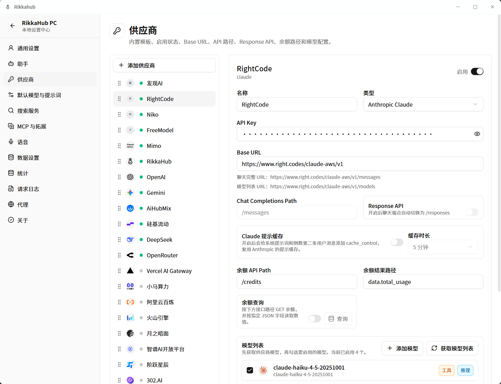
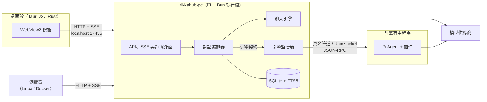

<div align="center"><a name="readme-top"></a>


# Rikkahub Desktop

**Rikkahub 是一款原生 LLM 用戶端，嵌入整合 Pi 等多款 Agent 實作🤖💬**

—— 支援 Windows、Linux 與 Docker。<br/>
基於作者 [@RE][re-ovo] 開發的 Android 版 [RikkaHub][rikkahub] 重構而成。

[English](README.md) · [简体中文](README_ZH_CN.md) · **繁體中文** · [官網][website] · [下載][releases-latest] · [Docker](#docker) · [回饋][issues]

[![][release-shield]][releases]
[![][downloads-shield]][releases]
[![][docker-shield]][docker-link]
[![][ci-shield]][ci-link]<br/>
[![][platform-shield]](#-快速開始)
[![][license-shield]](LICENSE)
[![][stars-shield]][stars-link]
[![][issues-shield]][issues]

</div>

<details>
<summary><kbd>目錄</kbd></summary>

- [Rikkahub Desktop](#rikkahub-desktop)
  - [✨ 功能特色](#-功能特色)
    - [💬 對話](#-對話)
    - [🧠 模型與供應商](#-模型與供應商)
    - [🛠️ 工作區會話](#️-工作區會話)
    - [🗂️ 會話歸你所有](#️-會話歸你所有)
    - [🔓 開放與可設定](#-開放與可設定)
    - [🔍 搜尋、語音與圖像](#-搜尋語音與圖像)
    - [💾 資料與備份](#-資料與備份)
    - [🖥️ 桌面體驗](#️-桌面體驗)
    - [🌊 To Be Continued…](#-to-be-continued)
  - [💎 贊助商](#-贊助商)
  - [🚀 快速開始](#-快速開始)
    - [Windows](#windows)
    - [Linux](#linux)
    - [Docker](#docker)
    - [社群建置](#社群建置)
    - [首次使用](#首次使用)
    - [命令列參數](#命令列參數)
  - [🔒 隱私與安全](#-隱私與安全)
  - [🏗️ 架構](#️-架構)
  - [⌨️ 開發](#️-開發)
    - [目錄結構](#目錄結構)
    - [環境準備](#環境準備)
    - [本機執行](#本機執行)
    - [檢查與測試](#檢查與測試)
    - [冒煙測試](#冒煙測試)
    - [建置](#建置)
    - [版本與發布](#版本與發布)
    - [維護 Pi](#維護-pi)
  - [🤝 參與貢獻](#-參與貢獻)
  - [🙏 致謝](#-致謝)
  - [⭐ Star 歷史](#-star-歷史)
  - [📄 授權條款](#-授權條款)
  - [🔗 友情連結](#-友情連結)

</details>

## ✨ 功能特色

Rikkahub Desktop 是一款桌面用戶端，基於 RikkaHub Android 重構。它可以作為原生 Windows 應用程式執行，也可以作為自帶相依套件的 Linux 二進位檔或 Docker 容器執行，在瀏覽器中使用。macOS 使用者可以使用[社群建置](#社群建置)。

<table>
  <tr>
    <td width="50%" valign="top">
      <b>💬 多供應商對話</b><br/>
      透過 OpenAI、Anthropic、Gemini 協定接入雲端或本機模型，支援訊息分支、多助理、記憶、MCP、網路搜尋與語音。
    </td>
    <td width="50%" valign="top">
      <b>🛠️ 桌面端的 Pi</b><br/>
      在工作區中執行 Pi Agent，依照你的想法執行動作、執行程式碼。
    </td>
  </tr>
  <tr>
    <td width="50%" valign="top">
      <b>🗂️ 會話歸你所有</b><br/>
      Agent 工作區會話與一般對話存放在同一個對話庫中，支援編輯、切換分支、搜尋和備份。引擎升級或當機都不會帶走歷史。
    </td>
    <td width="50%" valign="top">
      <b>🔄 與 RikkaHub APP 雙向互通</b><br/>
      手機上的備份可以在桌面端還原，桌面端的備份也可以在 APP 中還原。
    </td>
  </tr>
  <tr>
    <td width="50%" valign="top">
      <b>🔓 開放與可設定</b><br/>
      系統提示詞與各項內建任務的提示詞公開透明、均可編輯，請求可以附加自訂請求標頭與請求內容欄位。
    </td>
    <td width="50%" valign="top">
      <b>⚡ 內建提示快取最佳化</b><br/>
      最佳化快取命中，支援 Claude 快取斷點、OpenAI 快取路由，以及 Agent 長任務期間的快取預熱。
    </td>
  </tr>
</table>

### 💬 對話

<!--  -->

- **效能最佳化**：超長對話依舊流暢執行。
- **訊息佇列**：模型回答時也能繼續送出，排隊的訊息會在下一個自然間隙依序送出。
- **串流 Markdown 渲染**：程式碼高亮、LaTeX 與表格；HTML、SVG 和 Mermaid 程式碼區塊就地預覽。
- **訊息分支**：編輯任何訊息或重新生成任何回覆，保留每個版本，並可以從任何位置分岔出新對話。
- **助理**：獨立的系統提示詞、模型、參數、預設訊息、正規表示式取代，以及 `{{model_name}}`、`{{cur_datetime}}` 等範本變數。
- **記憶**：支援助理記憶與全域記憶兩個層級，支援參考最近的對話，並在長時間沒有訊息後注入模型目前的時間。
- **MCP / Skill**：MCP 服務支援 Streamable HTTP 與 SSE 兩種傳輸以及 OAuth 授權；技能可以從 GitHub 或本機檔案匯入。兩者都可以依助理設為預設，也可以為單一對話選擇。
- **世界書與提示詞注入**：世界書條目在最近的訊息命中關鍵字或正規表示式時注入，也可以設為始終生效；提示詞注入選中後每輪生效。兩者都可以插入到系統提示詞前後、對話開頭或結尾，以及指定的訊息深度。
- **全文搜尋**：所有對話，就地翻譯回覆，一鍵最佳化提示詞，匯出為 Markdown 或圖片。

### 🧠 模型與供應商

<!--  -->

- **原生協定**：OpenAI Chat Completions 與 Responses、Anthropic Messages、Google Gemini 以及 Gemini Interactions API。任何 OpenAI 相容端點都能接入，包括 [Ollama][ollama]、[LM Studio][lmstudio] 和 [llama.cpp][llamacpp] 提供的本機模型。
- **多種供應商支援**：OpenAI / Anthropic / Google Gemini + 任何 OpenAI 相容介面。
- **訂閱登入**，不需要 API Key：ChatGPT、Claude Pro / Max、SuperGrok / X Premium、GitHub Copilot 與 Kimi Code，憑證自動續期。Claude 訂閱僅能用於工作區會話。
- **支援本機模型**：透過 Ollama / LM Studio / llama.cpp server，將 OpenAI 相容供應商指向本機位址即可（如 Ollama 的 `http://localhost:11434/v1`）。
- **快取最佳化**：多種快取最佳化設計，拯救你的 Token。
- **七檔思考強度**，從「關閉」到「最大」，依各供應商自己的參數對應。

### 🛠️ 工作區會話

<!--  -->

工作區會話由開源程式設計 Agent [Pi][pi] 驅動。開啟一個專案資料夾，或使用 Rikkahub Desktop 管理的預設資料夾，Pi 即可在其中讀寫檔案、執行程式碼。

- **插件**：支援 Pi 生態系插件套件，支援自訂插件市集來源。
- **Windows 不需額外設定**：內建 Bash，在沒有找到本機 Git Bash 時使用。
- **結果可審閱**：修改以差異比對呈現，指令以終端機輸出呈現，檔案面板與對話並排。
- **執行中插話**：Pi 工作時送出的訊息，會在它的下一步被接收。

### 🗂️ 會話歸你所有

工作區會話與一般對話位於同一個對話庫，由 Rikkahub Desktop 儲存和管理。Pi 是驅動會話的引擎，不是會話的擁有者：它每一輪從應用程式讀取歷史，把每一步的結果交還給應用程式，本身不儲存會話檔案。

- **升級不丟歷史**：引擎升級、當機，或卡住後被自動重新啟動，會話紀錄都原樣保留，最多只有正在進行的那一輪以錯誤結束。
- **Agent 會話也能編輯**：修改任何一則訊息、重新生成、切換分支、從中途分岔出新會話，與一般對話完全一致，下一輪直接依改動後的歷史繼續。
- **原生接入，不經命令列**：Pi 以原始碼形式嵌入，訊息、工具呼叫與審批請求都以結構化事件交給應用程式，不解析終端機輸出；Pi 的版本隨應用程式一起鎖定，不會因單獨升級而失配。
- **搜得到，帶得走**：全文搜尋涵蓋 Agent 會話；會話隨備份遷移，也能匯出到 RikkaHub APP。
- **一套設定，兩種模式**：供應商與訂閱登入、MCP 與技能、代理和用量統計都由對話模式和工作區會話共用，不必為 Agent 另外設定一遍。
- **對開發者**：引擎是一套可 JSON 序列化契約背後的驅動程式。儲存、介面、搜尋、備份、審批與模型接入都由應用程式提供，引擎執行在受監管的獨立程序中。接入新引擎時，這些部分都不必重寫。

### 🔓 開放與可設定

- **所有提示詞均可編輯**：助理的系統提示詞，以及標題、建議、翻譯、OCR、上下文壓縮和提示詞最佳化背後的提示詞。
- **請求層級控制**：供應商、模型、助理三層自訂請求標頭，模型與助理層級自訂請求內容欄位，每個模型可單獨指定端點與 API Key。
- **場景模型**：標題與聊天建議、翻譯、提示詞最佳化、上下文壓縮、OCR 與圖像生成都可以單獨指定模型。
- **自訂搜尋**：用一小段 JavaScript 指令碼接入任何其他搜尋 API。

### 🔍 搜尋、語音與圖像

- **20 種網路搜尋服務**：包括 Tavily、Exa、Brave、Perplexity、Jina、Firecrawl、SearXNG、自訂 JS、…
- **多組 Key 管理**：失效或額度用盡時自動切換到下一組。
- **文字轉語音**：支援 12 種引擎，搭配即時語音辨識與免持語音模式。
- **圖像生成與編輯**：相容 OpenAI 風格的圖像介面與 Google Imagen，附帶圖庫。
- **附件**：圖片、PDF、DOCX、PPTX 與 EPUB。不支援視覺輸入的模型可以交由 OCR 模型辨識圖片。

### 💾 資料與備份

- **本機儲存**：對話由本機 SQLite 儲存。儲存時只寫入有變動的部分，長對話同樣流暢。
- **雙向備份**：桌面端可以匯入 APP 的備份，桌面端的備份也可以在 APP 中還原。
- **雲端備份**：支援 WebDAV 與任何 S3 相容儲存空間。

### 🖥️ 桌面體驗

<!--  -->

- 多套主題色（Claude / Mono / Vermillion / 自訂） + 🌙 深色模式
- 多分頁，支援左右分欄。
- 自訂快速鍵設計。
- 預設跟隨系統代理，也可以手動指定或強制直連，支援代理白名單與自訂 User-Agent。
- 含快取命中率的用量統計，以及便於排查問題的請求日誌。

### 🌊 To Be Continued…

<div align="center">

<picture>
  <source media="(prefers-color-scheme: dark)" srcset=".github/assets/whale-dark.svg" />
  
</picture>

**Pi 是第一位，但不會是最後一位。**

會話本就獨立於引擎儲存，下一位到來時，你的歷史會原樣接續。<br/>
*深海之下，有什麼正在緩緩上浮。*

</div>

<div align="right">

[![][back-to-top]](#readme-top)

</div>

## 💎 贊助商

感謝以下贊助商對 Rikkahub Desktop 開發的支持。

<table>
  <tr>
    <td width="120" align="center">
      <a href="https://naapi.cc"></a>
    </td>
    <td>
      <a href="https://naapi.cc"><b>钠API</b></a><br/>
      提供 ChatGPT、Claude、Gemini 等 100+ 全球頂級模型的統一介面，主打有競爭力的價格與出色的穩定性。
    </td>
  </tr>
</table>

也可以透過[愛發電][afdian]支持本專案。

<div align="right">

[![][back-to-top]](#readme-top)

</div>

## 🚀 快速開始

### Windows

從[最新發布][releases-latest]下載 `Rikkahub_<版本號>_x64-setup.exe` 並執行。

- 預設依使用者安裝到 `%LOCALAPPDATA%\Rikkahub\`，不需要系統管理員權限。
- 安裝時會詢問資料（對話、設定、上傳檔案）的儲存位置，預設為 `<安裝目錄>\pc-data\`。請選擇空間充足的磁碟，因為目前還不能在應用程式內更換資料目錄。
- 自帶 WebView2 引導程式，Windows 10 1809+ 與 Windows 11 可直接執行。
- 應用程式啟動時會檢查新版本，也可以在「設定 → 關於」中手動檢查。更新會下載新的安裝程式並覆蓋安裝，資料保持不變；解除安裝也不會刪除資料目錄。

每個版本還提供免安裝的 `Rikkahub_<版本號>_portable.zip`：解壓縮後執行 `rikkahub-pc.exe`，它會在瀏覽器中開啟介面，資料儲存在同目錄的 `pc-data\` 中。

### Linux

每個版本都提供 `Rikkahub_<版本號>_linux_x64.tar.gz`，內含自帶相依套件的二進位檔與網頁介面：

```bash
tar xzf Rikkahub_<版本號>_linux_x64.tar.gz
cd rikkahub-pc
./rikkahub-pc            # 在 http://localhost:17455 提供服務並自動開啟；資料儲存在 ./pc-data/
```

在無頭伺服器上執行時加上 `--no-open`；需要從區域網路存取時，使用 `--host 0.0.0.0` 並設定 `--password`（見[命令列參數](#命令列參數)）。Linux 版支援應用程式內更新：新版本會在原目錄中替換，重新啟動後生效。

部分功能會呼叫系統工具。缺少的工具會在啟動時列出，其餘功能不受影響。

| 套件 | 用途 |
| :-- | :-- |
| `espeak-ng` | 系統文字轉語音 |
| `xclip`（X11）或 `wl-clipboard`（Wayland） | 剪貼簿工具 |
| `unzip`、`zip` | 備份匯出與還原、從 ZIP 匯入技能 |

```bash
sudo apt install espeak-ng xclip unzip zip    # Debian / Ubuntu
sudo dnf install espeak-ng xclip unzip zip    # Fedora / RHEL
```

### Docker

多架構映像檔（amd64 / arm64）發布在 GitHub Container Registry：

```bash
docker run -d --name rikkahub \
  -p 8080:8080 \
  -v ./pc-data:/app/pc-data \
  -e RIKKAHUB_PASSWORD=change-me \
  ghcr.io/yuh-g/rikkahub-desktop:latest
```

也可以使用 Docker Compose：

```yaml
services:
  rikkahub:
    image: ghcr.io/yuh-g/rikkahub-desktop:latest
    container_name: rikkahub
    ports:
      - "8080:8080"
    volumes:
      - ./pc-data:/app/pc-data
    environment:
      RIKKAHUB_PASSWORD: change-me
      # HTTPS_PROXY: http://proxy.example:3128   # 需要代理時取消註解
    restart: unless-stopped
```

然後開啟 `http://localhost:8080`。

- **映像檔標籤**跟隨發布版本（`v2.0.0-preview-v5` 等），`latest` 為最新發布版，`main` 跟隨主分支。映像檔使用 cosign 簽章。
- **更新**時拉取新映像檔並重建容器即可，容器內不提供應用程式內更新。
- **代理**跟隨容器的 `HTTP_PROXY`、`HTTPS_PROXY` 與 `NO_PROXY` 環境變數。
- 映像檔已內建 `unzip` / `zip`；無頭容器中沒有剪貼簿和系統語音。
- 如需自行建置，在儲存庫根目錄執行 `docker build -t rikkahub .`。

> [!IMPORTANT]
> 容器監聽所有網路介面。只要他人能連到該連接埠，就請設定 `RIKKAHUB_PASSWORD`，否則對方可以看到你的對話和 API Key。

<details>
<summary><b>反向代理（nginx）</b></summary>

<br/>

需要保留 `Host` 請求標頭（伺服器會拒絕 `Origin` 與 `Host` 不一致的寫入請求，以防 CSRF），並關閉事件串流的緩衝：

```nginx
map $http_upgrade $connection_upgrade {
    default upgrade;
    ''      close;
}

server {
    listen 443 ssl;
    server_name rikka.example.com;
    # ssl_certificate ...; ssl_certificate_key ...;

    location / {
        proxy_pass http://127.0.0.1:8080;          # 直接執行二進位檔時為 17455
        proxy_set_header Host $host;
        proxy_http_version 1.1;
        proxy_set_header Upgrade $http_upgrade;   # WebSocket（語音輸入）
        proxy_set_header Connection $connection_upgrade;
        proxy_buffering off;
        proxy_read_timeout 1h;                    # 長時間的生成串流
        client_max_body_size 0;                   # 備份上傳可能有幾百 MB
    }
}
```

</details>

### 社群建置

以下安裝套件由社群成員維護，並非本專案官方維護，可能落後於最新版本。打包相關問題請向對應的維護者回報。

| 平台 | 安裝方式 | 維護者 |
| :-- | :-- | :-- |
| macOS | 從 [P-A-N-52/rikkahub-desktop][mac-port] 下載 Apple Silicon 或 Intel 的 `.dmg` | [@P-A-N-52](https://github.com/P-A-N-52) |
| Debian / Ubuntu / Mint | 從 [Releases][releases] 或[雲端硬碟][cloud-drive]下載 `.deb`，然後 `sudo apt install ./rikkahub-pc_*_amd64.deb` | [@Noah0932](https://github.com/Noah0932) |
| Arch / Manjaro | 從 [Releases][releases] 或[雲端硬碟][cloud-drive]下載 `.pkg.tar.zst`，然後 `sudo pacman -U rikkahub-pc-*-x86_64.pkg.tar.zst` | [@Noah0932](https://github.com/Noah0932) |
| NixOS / Nix | `nur.repos.af-nur.rikkahub-desktop`（從原始碼建置，二進位快取 `af-nur.cachix.org`）<br/>`nur.repos.af-nur.rikkahub-desktop-bin`（重新打包發布版二進位檔） | [@AstralFlare-owo](https://github.com/AstralFlare-owo) |

### 首次使用

1. **接入模型**：開啟「設定 → 模型 → 供應商」，填入任一供應商的 API Key；有 ChatGPT、Claude、SuperGrok、GitHub Copilot 或 Kimi Code 訂閱的，可以直接在對應供應商上點選「登入」。
2. **開始對話**：回到首頁新建對話，在輸入框中選擇模型、思考強度與網路搜尋。
3. **開啟工作區**：點選分頁列右側的「+」，選擇「預設工作區」或「開啟現有資料夾」，然後在輸入框左下角選擇權限檔位。
4. **從 APP 遷移**：在 RikkaHub APP 中匯出備份，再到「設定 → 資料管理 → 備份與還原」中匯入，對話、助理與設定會一併遷移過來。

### 命令列參數

| 參數 | 環境變數 | 預設值 | 作用 |
| :-- | :-- | :-- | :-- |
| `--port <n>` | `PORT` | `17455`（容器內 `8080`） | 監聽連接埠。容器外連接埠被佔用時自動順延到下一個空閒連接埠。 |
| `--host <addr>` | `RIKKAHUB_HOST` | `127.0.0.1` 與 `::1`（容器內 `0.0.0.0`） | 綁定位址。區域網路存取請用 `0.0.0.0`。 |
| `--password <pw>` | `RIKKAHUB_PASSWORD` | 無 | 網頁介面與 API 的存取密碼。 |
| `--no-open` | | 自動開啟瀏覽器 | 啟動時不開啟瀏覽器。 |
| | `RIKKAHUB_PC_DATA_DIR` | 程式旁的 `pc-data/` | 資料目錄。 |
| | `RIKKAHUB_ANALYTICS` | 發布版開啟 | 設為 `0` 關閉匿名使用統計。 |

<div align="right">

[![][back-to-top]](#readme-top)

</div>

## 🔒 隱私與安全

- **本機優先**：不需要註冊帳號。對話、設定和 Key 都儲存在你的資料目錄中，模型請求從你的電腦（或你設定的代理）直接送往你設定的供應商。
- **其他網路請求**：檢查更新會存取 GitHub；上下文長度等模型中繼資料每天最多從 [models.dev](https://models.dev) 取得一次；插件市集查詢 npm registry；搜尋結果的網站圖示與 Mermaid 預覽從公共服務載入。
- **匿名日活統計**：發布版會在啟動時及每 10 分鐘送出一次簡短請求，內容為隨機裝置 ID、應用程式版本、作業系統，以及送出訊息數、活躍分鐘數、失敗請求數等每日計數。不收集對話內容、提示詞、模型名稱或檔案名稱。設定 `RIKKAHUB_ANALYTICS=0` 即可關閉；從原始碼執行時從不送出。
- **預設僅限本機存取**：桌面版只監聽回環位址，並拒絕來自其他網頁來源的 API 請求。將服務公開到網路之前，請先設定存取密碼。
- **工作區邊界**：除「完全存取」外，寫入工作區資料夾以外的位置都需要你批准。讀取工具與終端機指令可以存取資料夾以外的檔案。
- **插件**：插件在你的電腦上執行於引擎程序中，沒有沙箱隔離。請只安裝你信任的插件。
- **共享部署**：`scrape_web` 工具會在執行 Rikkahub Desktop 的機器上擷取模型請求的任何 URL。部署在區域網路或公開網路時，如果內部服務不應被存取，請限制對外網路（SSRF）。

<div align="right">

[![][back-to-top]](#readme-top)

</div>

## 🏗️ 架構



- **單一執行檔**： `bun build --compile` 把後端與 Bun 執行環境編譯成一個檔案。React 介面從同目錄的 `web-ui/` 資料夾載入，因此同一個二進位檔既能服務桌面視窗，也能服務瀏覽器或容器。在 Windows 上，一個小型 Tauri 殼以 sidecar 方式啟動它，並負責視窗、系統匣與安裝程式。
- **引擎透過契約接入**： 編排器只透過一套可 JSON 序列化的契約與引擎互動：開始一輪、推送事件、請求審批、讀取與附加會話條目。聊天引擎在主程序內執行；Pi 及其插件執行在引擎宿主程序中，由監管器按需啟動、每 2 秒檢查一次存活，當機後重新啟動，插件變更後換用新程序。
- **兩層儲存**： 每個對話都以與引擎無關的紀錄保存，介面、搜尋和匯出到 APP 都只讀這一層。各引擎在旁邊保存自己的原生條目，只在與這層紀錄一致時重用，因此編輯、分支和切換引擎都不會讓引擎依據過時的歷史工作。
- **為長對話設計**： 儲存時只比對有變動的節點，全文索引依節點更新，跨程序傳輸只送出每段輸出與請求內容的新增部分。一旦這些開銷開始隨對話長度增長，測試就會失敗。

<details>
<summary><b>技術堆疊</b></summary>

<br/>

| 層 | 技術 |
| :-- | :-- |
| 執行環境與建置 | [Bun][bun] 1.4（`bun build --compile`）、TypeScript（strict） |
| 桌面殼 | [Tauri v2][tauri]、Rust、NSIS 安裝程式、WebView2 |
| 前端 | [React 19][react]、[React Router 7][react-router]（SPA 模式）、[Tailwind CSS v4][tailwind]、[shadcn/ui][shadcn]、[Zustand][zustand]、[TanStack Query][tanstack-query] |
| 渲染 | [Streamdown][streamdown]、[Shiki][shiki]、[KaTeX][katex]、Mermaid |
| 儲存 | `bun:sqlite` + FTS5（trigram） |
| 工作區 Agent | [Pi][pi]（vendored，一個本地補丁） |
| 文件解析 | [MuPDF][mupdf]（WebAssembly）解析 PDF；DOCX、PPTX、EPUB 使用內建解析器 |
| 國際化 | [i18next][i18next]（en-US、zh-CN） |

</details>

<div align="right">

[![][back-to-top]](#readme-top)

</div>

## ⌨️ 開發

### 目錄結構

```text
rikkahub-desktop/
├── pc-server/              # Bun 後端：API、對話編排、兩個引擎、備份、搜尋、語音
│   ├── conversations/      #   對話編排器、SSE 廣播、與引擎無關的對話紀錄
│   ├── engines/            #   應用程式與引擎之間的契約、聊天引擎驅動、模型出口
│   ├── inference-engine/   #   聊天引擎：供應商用戶端、工具迴圈、審批
│   ├── pi-engine/          #   Pi 驅動，以及與 Pi 原始碼之間的膠合層
│   ├── subprocess-engine/  #   引擎宿主程序：通道、訊框、交握、監管器
│   └── scripts/            #   冒煙測試與建置指令碼
├── web-ui/                 # React 19 單頁應用程式；src-tauri/ 是 Windows 桌面外殼
├── pi/                     # 固定版本的 Pi 原始碼（不在儲存庫中，依下文還原）
├── pi-patches/             # 本專案對 Pi 的修補
├── pi-model-data/          # Pi 內建模型目錄的離線快照
├── icons/  fonts/          # 供應商圖示與內建字型
├── docs/                   # 官網靜態頁與截圖
└── functions/              # 匿名使用統計的伺服端（Cloudflare Pages Functions）
```

從原始碼執行時，資料儲存在儲存庫根目錄的 `pc-data/`（已被 Git 忽略）。用 `RIKKAHUB_PC_DATA_DIR` 可以指向另一個目錄，便於和日常使用的資料分開。

### 環境準備

**前置條件：** [Bun][bun] 1.4.5（CI 與發布固定使用的版本；`bun build --compile` 嵌入的就是執行它的那個 Bun）和 Git。建置 Windows 安裝程式還需要 [Rust][rustup] 工具鏈、帶「使用 C++ 的桌面開發」工作負載的 [Visual Studio Build Tools 2022][vs-build-tools]，以及 [Git for Windows][git-for-windows]（應用程式內建的 bash 從它打包）。

**複製儲存庫並還原 Pi。** 後端直接引用 Pi 的 TypeScript 原始碼，因此 `pi/` 目錄下需要一份固定版本的 Pi，套用本專案的修補並放入模型資料快照。Windows 上請在 Git Bash 中執行：

```bash
git clone https://github.com/yuh-G/rikkahub-desktop.git
cd rikkahub-desktop

git clone --filter=blob:none --no-checkout https://github.com/earendil-works/pi.git pi
cd pi
git checkout dd30101cfc5b0609411dd80b6f93adbc14db14cf
git reset --hard
git apply --ignore-whitespace ../pi-patches/*.patch
bun install
mkdir -p packages/ai/src/providers/data
cp ../pi-model-data/*.json ../pi-model-data/.manifest.json packages/ai/src/providers/data/
bun packages/ai/scripts/check-model-data.ts
cd ..
```

上面的提交雜湊與 CI、Dockerfile 和 Linux 發布流程保持一致。最後一條指令檢查模型資料快照是否完整：快照與 Pi 版本不相符時，內建模型目錄會變成空的。

### 本機執行

在儲存庫根目錄開啟兩個終端機，分別執行：

```bash
cd pc-server && bun install && bun run dev    # API 在 http://localhost:17455，不會自動開啟瀏覽器
cd web-ui && bun install && bun run dev       # Vite 在 http://localhost:5173，/api 代理到 17455
```

然後在任何瀏覽器中開啟 `http://localhost:5173`。前端改動會熱更新；後端改動需要重新執行 `bun run dev`。自訂標題列只在桌面外殼中顯示，其餘介面在瀏覽器中完全可用。

工作區會話由主程式依需求啟動的引擎宿主程序執行，開發時不需要單獨啟動。主程式或引擎宿主異常退出時，資料目錄的 `logs/` 下會留下退出前的啟動紀錄。

### 檢查與測試

測試需要 `pc-server/assets/bash-bundle.tar.gz`，即 Windows 內建 bash 的壓縮檔，它不在儲存庫中。Windows 上用 `cd pc-server && bun run build:bash-bundle` 從本機的 Git for Windows 打包（`bun run compile` 也會執行這一步）；Linux 與 macOS 上放一個佔位檔案即可：`echo dummy > pc-server/assets/bash-bundle.tar.gz`。

```bash
(cd pc-server && bun run typecheck && bun test)
(cd web-ui && bun run typecheck && bun run test:unit)
```

- `pc-server` 的 `typecheck` 會濾掉 `pi/` 內部的診斷，只檢查本專案的程式碼以及對 Pi API 的使用。
- 測試中有一批架構守衛，例如主程式不得載入 Pi、對話層不得依賴特定引擎、跨程序傳輸的位元組數不得隨對話長度增長。守衛失敗時，錯誤訊息會說明違反了哪條約定。

> [!TIP]
> 執行測試和冒煙測試的終端機請先清除 `HTTP_PROXY`、`HTTPS_PROXY` 與 `ALL_PROXY`。Bun 對回送位址的請求同樣會走這些代理，而測試要存取本機的模擬服務。

### 冒煙測試

冒煙測試大多會啟動真實的伺服器或引擎宿主程序，搭配本機模擬的供應商、MCP 和 WebDAV 服務端對端執行，不存取外網，也不需要任何真實的 API Key。在 `pc-server` 目錄下執行：

| 指令 | 涵蓋範圍 | 何時執行 |
| :-- | :-- | :-- |
| `bun run smoke:request-chain` | 完整請求鏈路：Chat Completions 與 Responses、串流輸出、提示詞注入、技能、MCP、搜尋與本機工具、停止與重新生成、多助理並行、翻譯、上下文壓縮、備份與 WebDAV、圖像生成 | 每次提交前（CI 必跑） |
| `bun run smoke:backup-roundtrip` | 桌面端 → zip → 桌面端，以及桌面端 → APP 資料庫 → 桌面端的往返，附件去重，以及缺少 APP 資料庫或只含設定時的還原 | 改動備份、設定或儲存時（CI 必跑） |
| `bun run smoke:engine-contract` | 在真實的引擎宿主程序中執行 Pi：工具呼叫 → 審批 → 插話 → 插件讀取 → 中止，以及代理設定向宿主程序的傳遞 | 改動引擎、契約或 Pi 時（CI 必跑） |
| `bun run smoke:upgrade` | 上一個發布版寫下的資料能在新版中開啟，續聊時送給模型的歷史不變；再用上一個發布版的 exe 開啟新版寫過的資料 | 改動儲存格式時 |
| `bun run smoke:proxy-behavior` | Bun 執行階段選擇代理的行為，以及應用程式對每個請求的代理決定 | 升級 Bun 後 |
| `bun run smoke:embedded-bash` | 內建 bash 的解壓縮與執行（僅 Windows） | 改動內建 bash 時 |
| `bun run smoke:pi-plugins` | 一組固定版本的 Pi 生態系插件在應用程式中的載入、工具、對話框與指令 | 升級 Pi 後（需要在本機準備插件副本） |

`smoke:upgrade` 的最後一步需要上一個發布版的 `rikkahub-pc.exe`，預設在 `dist/` 下的可攜版目錄中尋找，也可以用 `RIKKAHUB_UPGRADE_BASELINE_EXE` 指定；找不到時會跳過這一步並說明原因。冒煙測試使用 18100–18300 之間的本機連接埠，連接埠被佔用時可以用 `SMOKE_PC_PORT` 等環境變數調整。

### 建置

```powershell
# Windows 安裝程式：編譯伺服器 sidecar、建置介面，再產生 NSIS 安裝程式
cd web-ui
bun run tauri:build
# → web-ui/src-tauri/target/release/bundle/nsis/Rikkahub_<版本號>_x64-setup.exe
```

如果建置時找不到 MSVC 的 `link.exe`（Git Bash 自帶一個同名的 `link`），或者專案路徑中的非 ASCII 字元導致出錯，請先在 `pc-server` 中執行 `bun run compile`，再執行 `web-ui\src-tauri\tauri-msvc.cmd build`。這個指令碼會啟用 MSVC 環境，並在 `C:\rikkahub-build` 中建置。

```bash
# Windows 可攜目錄：dist/ 即可直接執行（rikkahub-pc.exe + web-ui/ + icons/ + fonts/）
cd web-ui && bun run build                  # 建置介面並複製到 dist/web-ui/
cd ../pc-server && bun run compile          # → dist/rikkahub-pc.exe，同時同步 icons/ 與 fonts/

# Linux 二進位檔
cd web-ui && bun run build
cd ../pc-server && bun run compile:linux    # → dist/rikkahub-pc

# Docker 映像檔（多架構建置在 CI 中完成）
docker build -t rikkahub .
```

> [!NOTE]
> Windows 上 Git 預設把換行轉換為 CRLF，而映像檔建置會在容器裡套用 `pi-patches/` 中的修補。在 Windows 上建置映像檔時，請用已提交的原始碼作為建置上下文：`git -c core.autocrlf=false archive HEAD | docker build -t rikkahub -`。

### 版本與發布

- **版本號**出現在四處：`pc-server/updates/index.ts`、`web-ui/src-tauri/tauri.conf.json`、`web-ui/src-tauri/Cargo.toml` 和關於頁。用 `cd pc-server && bun run version:bump <版本號>` 一次改完，CI 會檢查四處是否一致。`dist/latest.txt` 中的版本指標需要另外手動更新。
- **推送 `v*.*.*` 標籤**後，GitHub Actions 會建置 Linux 的 `tar.gz` 並附加到對應的 Release，同時發布 Docker 映像檔。Windows 安裝程式與可攜版在本機建置後上傳到同一個 Release。
- **應用程式內更新**依檔名比對 Release 中的資產（`Rikkahub_<標籤>_x64-setup.exe`、`Rikkahub_<標籤>_linux_x64.tar.gz`），上傳時請不要改名。

### 維護 Pi

Pi 以原始碼形式固定在一個上游提交上，本專案的改動以修補形式放在 `pi-patches/`。每個修補都需要三樣東西：程式碼中的 `[RIKKAHUB PATCH: <名稱>]` 標記、`pi-patches/` 中匯出的修補檔，以及宿主側鎖定其行為的測試，修補遺失時測試會失敗。修補只用於增加功能或增加可注入點，不為了消除型別檢查雜訊修改 Pi 的原始碼。`bun run typecheck` 會濾掉 `pi/` 內部的診斷，所以改動 Pi 的檔案後，請在 `pc-server` 中直接執行 `bunx tsc --noEmit`，比對改動前後這些檔案的診斷，確認沒有新增。

<details>
<summary><b>升級 Pi 的步驟</b></summary>

<br/>

1. 閱讀目前基線與目標版本之間各套件 `CHANGELOG.md` 中的 Breaking Changes，對照後端引用的 Pi 檔案（`grep -rn "pi/packages/" pc-server --include=*.ts`）逐項判斷相容性。
2. 在 `pi/` 中拉取新版本，先建回滾分支，再把本機修補 rebase 到新基線上，確認所有 `RIKKAHUB PATCH` 標記仍然存在，然後重新匯出 `pi-patches/`。上游已經原生支援的修補應當刪除。
3. 更新模型資料快照。不要執行 `generate-models`，它依當天的線上資料產生，結果無法重現。改用 Pi 自帶的內容定址目錄離線產生：

   ```bash
   cd pi
   REV=$(node -p "require('./nix/model-catalog.json').revision")
   curl -fsSL "https://pi.dev/api/models/revisions/${REV}?types=chat,image,classifier" -o ../models.all.json
   echo "${REV#sha256-}  ../models.all.json" | sha256sum -c -
   node packages/ai/scripts/hydrate-model-catalog.ts ../models.all.json
   node packages/ai/scripts/check-model-data.ts
   ```

   然後用 `packages/ai/src/providers/data/` 下的 `*.json` 與 `.manifest.json` 整體取代 `pi-model-data/`，並刪除 `models.all.json`。
4. 把新基線的完整提交雜湊同步到 `.github/workflows/ci.yml`（兩處）、`.github/workflows/build-linux.yml`、`Dockerfile` 和本文件。
5. 執行兩端的型別檢查與單元測試、`smoke:engine-contract` 和 `smoke:pi-plugins`，再實際編譯一次 exe，走一遍工作區會話（工具、審批、插話、壓縮）與訂閱登入。

</details>

<div align="right">

[![][back-to-top]](#readme-top)

</div>

## 🤝 參與貢獻

歡迎提交問題回報、功能建議和 Pull Request。較大的改動請先[開一個 issue][issues] 討論方案。

- Pull Request 請提交到 `main` 分支。CI 會執行兩端的型別檢查與單元測試、版本號一致性檢查、桌面外殼的 `cargo check`，以及請求鏈路、備份往返和引擎契約冒煙測試。提交前請先在本機跑一遍[檢查與測試](#檢查與測試)。
- 面向使用者的文案需要同時寫入 `web-ui/app/locales/en-US` 與 `zh-CN`。
- 修改設定項、列舉或儲存的資料時，請確認備份仍能與 RikkaHub APP 互相匯入。

<a href="https://github.com/yuh-G/rikkahub-desktop/graphs/contributors">
  
</a>

## 🙏 致謝

- [RE][re-ovo] 的 [RikkaHub][rikkahub]：本專案的產品設計與品牌以這款安卓應用程式為基礎。
- Mario Zechner 的 [Pi][pi]：工作區會話背後的程式設計 Agent。
- [@karuboniru](https://github.com/karuboniru) 完成了 Linux 移植與 Docker 支援；也感謝每一位貢獻者，以及上文列出的社群打包者。
- [LobeHub Icons](https://github.com/lobehub/lobe-icons) 提供供應商與模型圖示。

## ⭐ Star 歷史

<a href="https://star-history.com/#yuh-G/rikkahub-desktop&Date">
  <picture>
    <source media="(prefers-color-scheme: dark)" srcset="https://api.star-history.com/svg?repos=yuh-G/rikkahub-desktop&type=Date&theme=dark" />
    
  </picture>
</a>

## 📄 授權條款

Rikkahub Desktop 採用分段雙重授權：

- **[GNU AGPL v3](https://www.gnu.org/licenses/agpl-3.0.html)**：適用於非商業用途，個人、教育與研究用途，以及使用者總數不超過 50 人的個人或組織。
- **商業授權**：適用於商業用途、使用者超過 50 人，或希望免除 AGPL 義務的情況。聯絡方式見授權檔案。

完整條款見 [LICENSE](LICENSE)。

## 🔗 友情連結

- [LINUX DO](https://linux.do/) — 新的理想型社群

<div align="right">

[![][back-to-top]](#readme-top)

</div>

<!-- LINK GROUP -->

[afdian]: https://afdian.com/a/mirsky
[back-to-top]: https://img.shields.io/badge/-BACK_TO_TOP-151515?style=flat-square
[bun]: https://bun.sh/
[ci-link]: https://github.com/yuh-G/rikkahub-desktop/actions/workflows/ci.yml
[ci-shield]: https://img.shields.io/github/actions/workflow/status/yuh-G/rikkahub-desktop/ci.yml?branch=main&label=ci&labelColor=black&logo=githubactions&logoColor=white&style=flat-square
[cloud-drive]: https://1842911757.share.123pan.cn/123pan/oW0UTd-irzxh
[docker-link]: https://github.com/yuh-G/rikkahub-desktop/pkgs/container/rikkahub-desktop
[docker-shield]: https://img.shields.io/badge/docker-ghcr.io-369eff?labelColor=black&logo=docker&logoColor=white&style=flat-square
[downloads-shield]: https://img.shields.io/github/downloads/yuh-G/rikkahub-desktop/total?color=45cc11&labelColor=black&style=flat-square
[git-for-windows]: https://gitforwindows.org/
[i18next]: https://www.i18next.com/
[issues]: https://github.com/yuh-G/rikkahub-desktop/issues
[issues-shield]: https://img.shields.io/github/issues/yuh-G/rikkahub-desktop?color=ff80eb&labelColor=black&style=flat-square
[katex]: https://katex.org/
[license-shield]: https://img.shields.io/badge/license-AGPL--3.0%20%2B%20commercial-white?labelColor=black&style=flat-square
[llamacpp]: https://github.com/ggml-org/llama.cpp
[lmstudio]: https://lmstudio.ai/
[mac-port]: https://github.com/P-A-N-52/rikkahub-desktop
[mupdf]: https://mupdf.com/
[ollama]: https://ollama.com/
[pi]: https://github.com/earendil-works/pi
[platform-shield]: https://img.shields.io/badge/platform-Windows%20%7C%20Linux%20%7C%20Docker-0078d4?labelColor=black&style=flat-square
[re-ovo]: https://github.com/re-ovo
[react]: https://react.dev/
[react-router]: https://reactrouter.com/
[release-shield]: https://img.shields.io/github/v/release/yuh-G/rikkahub-desktop?color=369eff&labelColor=black&logo=github&style=flat-square
[releases]: https://github.com/yuh-G/rikkahub-desktop/releases
[releases-latest]: https://github.com/yuh-G/rikkahub-desktop/releases/latest
[rikkahub]: https://github.com/rikkahub/rikkahub
[rustup]: https://rustup.rs/
[shadcn]: https://ui.shadcn.com/
[shiki]: https://shiki.style/
[stars-link]: https://github.com/yuh-G/rikkahub-desktop/stargazers
[stars-shield]: https://img.shields.io/github/stars/yuh-G/rikkahub-desktop?color=ffcb47&labelColor=black&style=flat-square
[streamdown]: https://streamdown.ai/
[tailwind]: https://tailwindcss.com/
[tanstack-query]: https://tanstack.com/query
[tauri]: https://tauri.app/
[vs-build-tools]: https://visualstudio.microsoft.com/visual-cpp-build-tools/
[website]: https://rikkahub-desktop.pages.dev/
[zustand]: https://zustand.docs.pmnd.rs/
